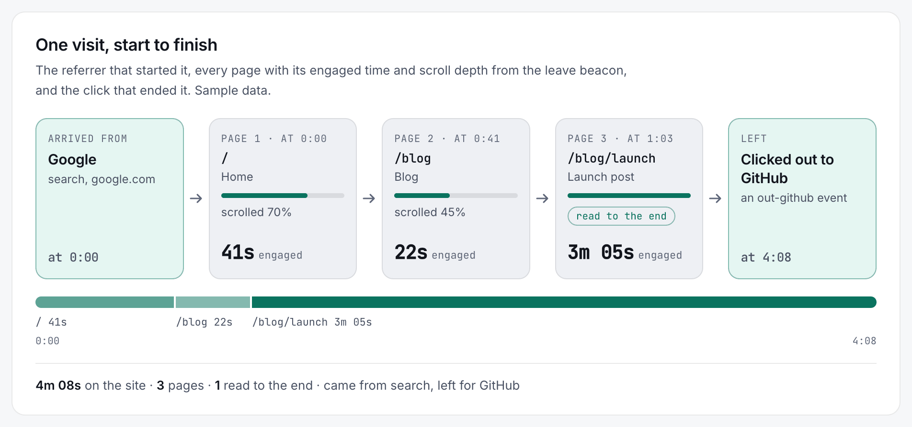
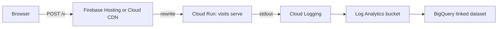
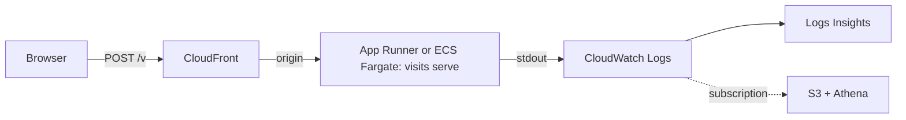
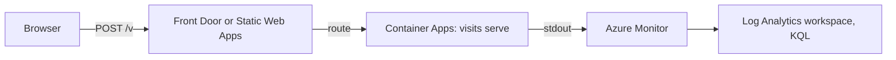

# lib-visits

<picture>
  <source media="(prefers-color-scheme: dark)" srcset="docs/images/journey-dark.png">
  
</picture>

One visit as lib-visits sees it: where it came from, each page with its engaged time and scroll depth, and how it ended (sample data).

Visits and journeys for your site. No cookies, no storage unless you opt out, no fingerprinting.
One script of **3,068 bytes** minified on the page and a **1.1 MB** static binary on the
server, which as a `FROM scratch` image is 0.6 MB compressed, idling at **2.6 MiB** of
memory, that writes what it sees as JSON lines.

- **Counts visits, not pageviews.** A visit is a keyed hash of the day, the address
  and the browser: it cannot survive the day and the address is never written.
- **Knows the path a visit took.** Same-site referrers chain pageviews together;
  a `leave` beacon carries engaged seconds, scroll depth and whether the end was read.
- **Carries real-user Web Vitals**, optionally, in a second script of **995 bytes**.
- **Yours.** The collector is a static binary that runs anywhere; events come out
  of stdout as JSON lines and go wherever you keep logs. GPL-3.0.

## Setup

1. **[Download `visits`](https://github.com/csarkosh/lib-visits/releases/latest)** for Linux (x86-64 or ARM64, static) or macOS (Apple silicon); `visits.min.js` is beside it.
2. Run it: `VISITS_SECRET=$(openssl rand -hex 32) ./visits serve --origin https://example.com`
3. Add the tag: ``

Or build it: `cargo build --release -p visits`, or the Dockerfile for the same binary in an empty image.

Each event is one JSON line on stdout. Pages on localhost or file: are not counted unless the
tag also carries `data-visits-local`.

### Behind your site

Proxy the path so the beacon is same-origin (no CORS, fewer blockers), use `data-visits="/v"`,
and tell the collector how many proxies sit in front: `--trusted-proxies 1` behind this nginx
block. Too low and every visitor shares the proxy's address, too high and none has a visit; confirm it once with `--log-ip`.

    location = /v {
        proxy_set_header X-Forwarded-For $proxy_add_x_forwarded_for;
        proxy_pass http://127.0.0.1:8080;
    }

## Running it in the cloud

The site's host rewrites `/v` to the collector, the collector writes to stdout, the cloud keeps
the lines. The address stops at the collector; the logs hold only the JSON lines.

**GCP**: scales to zero. Behind a Firebase Hosting rewrite the depth is 2 (Hosting and Cloud Run's frontend).

**AWS**: not zero at idle; the smallest Fargate task is a few dollars a month, App Runner paused bills memory only.

**Azure**: scales to zero on the Container Apps consumption plan.

**Your own box**: nginx or Caddy in front, `--sink file:/var/log/visits.jsonl`, and logrotate with `copytruncate` (the file is opened once, in append mode).

## More

- Sinks: `--sink stdout` (default) or `--sink file:<path>`.
- Your own visits: `--ignore-ips 203.0.113.9,2001:db8::/32` (or `VISITS_IGNORE_IPS`) answers
  beacons from those addresses and writes nothing.
- Event time: each line's `time` is the browser's clock at the event (when within five minutes
  of receipt), so beacons that arrive together after a cold start keep their order.
- Countries: build with `--features geoip` and pass `--geoip GeoLite2-Country.mmdb`
  (or DB-IP Lite, CC BY 4.0).
- Web Vitals: add `` after the core.
- Behind a proxy: `--trusted-proxies N` (the client is the Nth address from the
  right of `X-Forwarded-For`; only the first `X-Forwarded-For` header line is read); confirm once with `--log-ip`, then turn it off.
- Opt out: load any page with `#visits-off`; `#visits-on` undoes it.
- The secret: keep it out of wherever the events go, and rotate it when you like;
  whoever holds both the secret and the events can test whether a given address and
  browser visited on a given day, and a rotation ends every visit at that moment.
- Another language: `spec/SPEC.md` is the whole contract.
- Not collected, on purpose: canvas, WebGL, audio, fonts, high-entropy client
  hints, the query string beyond campaign parameters, anything across days.
