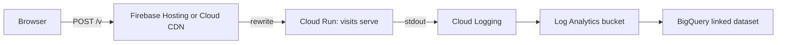
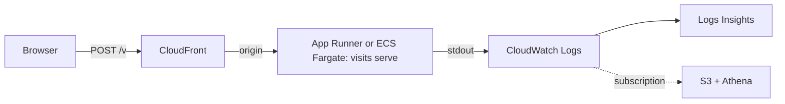
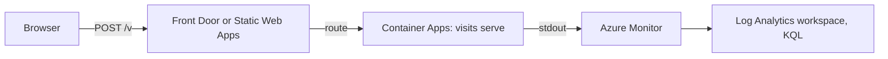

# lib-visits

Visits and journeys for your site. No cookies, no storage unless you opt out, no fingerprinting.
One script of **3,068 bytes** minified on the page and a **1.1 MB** static binary on the
server, which as a `FROM scratch` image is 0.6 MB compressed, idling at **2.6 MiB** of
memory, that writes what it sees as JSON lines.

- **Counts visits, not pageviews.** A visit is a keyed hash of the day, the address
  and the browser: it cannot survive the day and the address is never written.
- **Knows the path a visit took.** Same-site referrers chain pageviews together;
  a `leave` beacon carries engaged seconds, scroll depth and whether the end was read.
- **Carries real-user Web Vitals**, optionally, in a second script of **995 bytes**.
- **Yours.** The collector is a static binary that runs anywhere; events come out
  of stdout as JSON lines and go wherever you keep logs. GPL-3.0.

## Setup

1. Build and run it

       cargo build --release -p visits
       VISITS_SECRET=$(openssl rand -hex 32) ./target/release/visits serve --origin https://example.com

   Or build the Dockerfile, which gives the same binary in an empty image.

2. Serve the script and add the tag. Copy `client/dist/visits.min.js` to your site and load it:

       

3. Watch the lines

       {"v":1,"n":"view","id":"k3j9x2m1ab","p":"/","t":"Home", ... ,"s":{"at":"2026-10-15T02:40:30Z","visit":"3f9a1c0e5b7d2a46","bn":"Firefox","bv":128,"os":"macOS","rk":"external","rh":"google.com", ...}}

   Pages on localhost or file: are not counted unless the tag also carries
   `data-visits-local`, so try it on the real origin, or add that attribute while you test.

### Put it behind your site

So the beacon is same-origin (no CORS, fewer blockers), proxy the path:

    location = /v {
        proxy_set_header X-Forwarded-For $proxy_add_x_forwarded_for;
        proxy_pass http://127.0.0.1:8080;
    }

Use `data-visits="/v"` and run `visits serve --trusted-proxies 1`: behind any proxy the depth must be set, and a depth wrong in either direction puts every visitor in one rate-limit bucket and ends visits; confirm it once with `--log-ip`.

## Running it in the cloud

The shape is the same everywhere: the site's host rewrites the beacon path to the
collector, the collector writes to stdout, the cloud's log service keeps the lines,
and a query layer reads them.

### GCP

Idle: nothing, Cloud Run scales to zero. The address reaches the collector and stops there; Cloud Logging holds only the JSON lines. Behind a Hosting rewrite, `--trusted-proxies` must be set; confirm the depth once with `--log-ip`.

### AWS

Idle: not zero. The smallest Fargate task is a few dollars a month; App Runner paused bills memory only. The address stops at the collector; CloudWatch holds only the lines.

### Azure

Idle: nothing on the Container Apps consumption plan, which scales to zero. The address stops at the collector; Log Analytics holds only the lines.

### Your own box

nginx or Caddy in front, `--sink file:/var/log/visits.jsonl`, logrotate: rotate it with logrotate's `copytruncate` (the file is opened once, in append mode).

## More

- Sinks: `--sink stdout` (default) or `--sink file:<path>`.
- Countries: build with `--features geoip` and pass `--geoip GeoLite2-Country.mmdb`
  (or DB-IP Lite, CC BY 4.0).
- Web Vitals: add `` after the core.
- Behind a proxy: `--trusted-proxies N` (the client is the Nth address from the
  right of `X-Forwarded-For`; only the first `X-Forwarded-For` header line is read); confirm once with `--log-ip`, then turn it off.
- Opt out: load any page with `#visits-off`; `#visits-on` undoes it.
- The secret: keep it out of wherever the events go, and rotate it when you like;
  whoever holds both the secret and the events can test whether a given address and
  browser visited on a given day, and a rotation ends every visit at that moment.
- Another language: `spec/SPEC.md` is the whole contract.
- Not collected, on purpose: canvas, WebGL, audio, fonts, high-entropy client
  hints, the query string beyond campaign parameters, anything across days.
