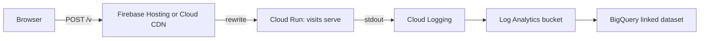
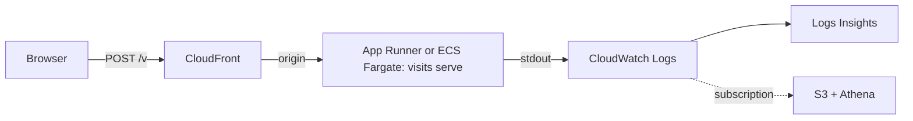
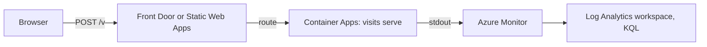

# lib-visits

Visits and journeys for your site. No cookies, no storage, no fingerprinting.
One script of **3,068 bytes** on the page and one binary of **1.1 MB** on the server,
idling at **2.6 MiB** of memory, that writes what it sees as JSON lines.

- **Counts visits, not pageviews.** A visit is a keyed hash of the day, the address
  and the browser: it cannot survive the day and the address is never written.
- **Knows the path a visit took.** Same-site referrers chain pageviews together;
  a `leave` beacon carries engaged seconds, scroll depth and whether the end was read.
- **Carries real-user Web Vitals**, optionally, in a second script of 995 bytes.
- **Yours.** The collector is a static binary that runs anywhere; events come out
  of stdout as JSON lines and go wherever you keep logs. GPL-3.0.

## Setup

1. Run it

       VISITS_SECRET=$(openssl rand -hex 32) ./visits serve --origin https://example.com

2. Add the tag

       

3. Watch the lines

       {"v":1,"n":"view","id":"k3j9x2m1ab","p":"/","t":"Home", ... ,"s":{"at":"2026-10-15T02:40:30Z","visit":"3f9a1c0e5b7d2a46","bn":"Firefox","bv":128,"os":"macOS","rk":"external","rh":"google.com", ...}}

### Put it behind your site

So the beacon is same-origin (no CORS, fewer blockers), proxy the path:

    location = /v { proxy_pass http://127.0.0.1:8080; }

and use `data-visits="/v"`.

## Running it in the cloud

The shape is the same everywhere: the site's host rewrites the beacon path to the
collector, the collector writes to stdout, the cloud's log service keeps the lines,
and a query layer reads them. All three scale to zero; the address stops at the
collector and never reaches the logs. The container image is 0.6 MB.

### GCP

### AWS

### Azure

### Your own box

nginx or Caddy in front, `--sink file:/var/log/visits.jsonl`, logrotate.

## More

- Sinks: `--sink stdout` (default) or `--sink file:<path>`.
- Countries: build with `--features geoip` and pass `--geoip GeoLite2-Country.mmdb`
  (or DB-IP Lite, CC BY 4.0).
- Web Vitals: add `` after the core.
- Behind a proxy: `--trusted-proxies N` (the client is the Nth address from the
  right of `X-Forwarded-For`); confirm once with `--log-ip`, then turn it off.
- Opt out: load any page with `#visits-off`; `#visits-on` undoes it.
- Another language: `spec/SPEC.md` is the whole contract.
- Not collected, on purpose: canvas, WebGL, audio, fonts, high-entropy client
  hints, the query string beyond campaign parameters, anything across days.
