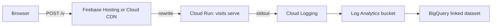
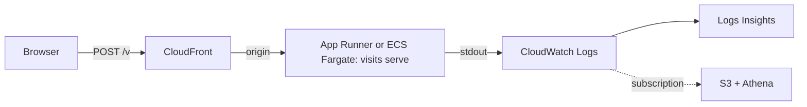
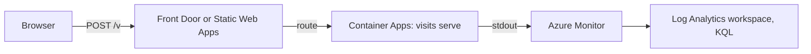

# lib-visits Implementation Plan

> **For agentic workers:** REQUIRED SUB-SKILL: Use superpowers:subagent-driven-development (recommended) or superpowers:executing-plans to implement this plan task-by-task. Steps use checkbox (`- [ ]`) syntax for tracking.

**Goal:** A cookieless web analytics library: a client script under 3,072 bytes (plus an optional 1,024-byte Web Vitals module) and a Rust collector that runs as one static binary and emits decorated events as JSON lines.

**Architecture:** The wire format (`spec/SPEC.md` and `spec/fixtures/*.json`) is written first and both ends are tested against it. The client is a single IIFE run under `node:test` in a `vm` context with a hand-made fake browser. The server is a Cargo workspace: `visits-core` is pure (validate, decorate, hash, classify) with no I/O and no HTTP type in it; `visits` is the binary (clap, axum, sinks, limiter).

**Tech Stack:** JavaScript (ES2018, esbuild for minify only, `node:test`); Rust stable, edition 2021, `axum`, `tokio`, `serde`/`serde_json`, `serde_urlencoded`, `hmac`/`sha2`, `clap`, `anyhow`; `maxminddb` behind the cargo feature `geoip`.

**Spec:** `docs/superpowers/specs/2026-10-15-lib-visits-design.md`

## Global Constraints

- Licence `GPL-3.0-only` everywhere: `Cargo.toml` workspace package, `client/package.json`, file headers not required.
- Rust: edition 2021, `rust-toolchain.toml` channel `stable`, workspace `members = ["crates/*"]`, `resolver = "2"`.
- Node 20+ for the client's build and tests; the client itself targets browsers with `sendBeacon`, `fetch`, `IntersectionObserver`, `PerformanceObserver`, and throws nothing elsewhere.
- Size gates: `client/dist/visits.min.js` ≤ 3,072 bytes; `client/dist/vitals.min.js` ≤ 1,024 bytes; minified, uncompressed; enforced by `client/test/size.test.mjs`.
- Runtime dependencies of the binary: `axum`, `tokio`, `serde`, `serde_json`, `serde_urlencoded`, `hmac`, `sha2`, `clap`, `anyhow`; `maxminddb` only under feature `geoip`. No `regex`, no `tracing`, no `chrono`/`time`.
- The client has zero runtime dependencies and one devDependency, `esbuild`.
- No cookies, no storage except `localStorage.visits = "off"` written on `#visits-off`; no fingerprinting API (no canvas, WebGL, audio, fonts, high-entropy client hints).
- Health route is `/healthcheck`, never `/healthz`.
- Every answer carries `cache-control: no-store`. Statuses: `204` accepted, `400` malformed, `403` origin, `413` too large, `429` limited, `405` other methods on the beacon path.
- Caps: body 16 KB; ≤ 50 events a request; `p` and `r` ≤ 2,048 chars; `t` ≤ 200; campaign values ≤ 100; `d` ≤ 10 keys, string values ≤ 200; custom names match `^[a-z][a-z0-9_-]{0,31}$`.
- No em-dashes in any file (docs, README, comments, commit messages).
- Commit messages: Conventional Commits subject, a short body saying why. No `git add -A`.

## Review Focus

1. A canonical link with a non-http scheme (`javascript:`, `mailto:`) or a different host must not replace the path: `view.p` stays `location.pathname`. Pinned in Task 4.
2. `X-Forwarded-For` with spaces, an empty entry or garbage (`"  , abc"`) must not crash the server or key everyone on one bucket: the resolved address becomes `None`, the limiter keys on `"unknown"`, and the event is still accepted without a `visit`. Pinned in Task 12.
3. A GET beacon whose `d` is not valid JSON, or whose numeric field is `"abc"`, answers `400` and nothing is written. Pinned in Task 9.
4. An array body in which one event is invalid is refused whole (`400`), never partially written. Pinned in Task 9.
5. `navigator.sendBeacon` returning `false` (the browser's beacon queue is full) must fall through to `fetch` with `keepalive`. Pinned in Task 7.

---

### Task 1: Repository scaffold

**Files:**
- Create: `Cargo.toml`, `rust-toolchain.toml`, `.gitignore`, `AGENTS.md`, `CLAUDE.md`, `client/package.json`, `crates/visits-core/Cargo.toml`, `crates/visits-core/src/lib.rs`, `crates/visits/Cargo.toml`, `crates/visits/src/main.rs`

**Interfaces:**
- Produces: the workspace every later task builds in; `cargo test` and `npm test` (in `client/`) both run green with zero tests.

- [ ] **Step 1: Write the workspace files**

`Cargo.toml`:
```toml
[workspace]
members = ["crates/*"]
resolver = "2"

[workspace.package]
version = "0.1.0"
edition = "2021"
license = "GPL-3.0-only"
repository = "https://github.com/csarkosh/lib-visits"

[workspace.dependencies]
visits-core = { path = "crates/visits-core" }
serde = { version = "1", features = ["derive"] }
serde_json = "1"
serde_urlencoded = "0.7"
anyhow = "1"
hmac = "0.12"
sha2 = "0.10"

[profile.release]
opt-level = "z"
lto = true
codegen-units = 1
panic = "abort"
strip = true
```

`rust-toolchain.toml`:
```toml
[toolchain]
channel = "stable"
```

`.gitignore` already exists on the branch (`target/`, `node_modules/`, `*.mmdb`, `.worktrees/`, `.superpowers/`); leave it as it is.

`crates/visits-core/Cargo.toml`:
```toml
[package]
name = "visits-core"
version.workspace = true
edition.workspace = true
license.workspace = true
description = "The pure half of lib-visits: validate, decorate and hash events."

[dependencies]
serde.workspace = true
serde_json.workspace = true
serde_urlencoded.workspace = true
hmac.workspace = true
sha2.workspace = true
```

`crates/visits-core/src/lib.rs`:
```rust
//! The pure half of lib-visits: no I/O, no HTTP type. Everything here is a
//! function of its arguments, tested against `spec/fixtures/`.
```

`crates/visits/Cargo.toml`:
```toml
[package]
name = "visits"
version.workspace = true
edition.workspace = true
license.workspace = true
description = "The lib-visits collector: one static binary that takes beacons and emits JSON lines."

[[bin]]
name = "visits"
path = "src/main.rs"

[features]
geoip = ["dep:maxminddb"]

[dependencies]
visits-core.workspace = true
serde.workspace = true
serde_json.workspace = true
anyhow.workspace = true
axum = "0.8"
tokio = { version = "1", features = ["rt-multi-thread", "macros", "net", "signal"] }
clap = { version = "4", features = ["derive", "env"] }
maxminddb = { version = "0.24", optional = true }
```

`crates/visits/src/main.rs`:
```rust
fn main() {
    println!("visits");
}
```

`client/package.json`:
```json
{
  "name": "lib-visits-client",
  "version": "0.1.0",
  "private": true,
  "license": "GPL-3.0-only",
  "type": "module",
  "scripts": {
    "build": "node build.mjs",
    "test": "node build.mjs && node --test test/"
  },
  "devDependencies": {
    "esbuild": "0.25.0"
  }
}
```

`AGENTS.md`:
```markdown
# lib-visits: working context

A cookieless web analytics library: `client/` (one script under 3 KB, an optional
Web Vitals module) and `crates/` (a Rust collector, one static binary). Design:
`docs/superpowers/specs/2026-10-15-lib-visits-design.md`. The wire format is
`spec/SPEC.md`; `spec/fixtures/*.json` are read by both test suites.

- `cargo test` and, in `client/`, `npm test` are the gates. Run the targeted suite for
  what changed; never run anything heavy in the background.
- Size gates: `visits.min.js` ≤ 3,072 B, `vitals.min.js` ≤ 1,024 B. A change that
  breaks one is trimmed, not waved through.
- No cookies, no storage (except the visitor's `#visits-off`), no fingerprinting API.
- No em-dashes. Conventional Commits. Stage paths explicitly, never `git add -A`.
- `docs/superpowers/` holds specs and plans and is never published.
```

`CLAUDE.md`:
```markdown
All working context for this repo lives in [AGENTS.md](./AGENTS.md).

@AGENTS.md
```

- [ ] **Step 2: Build and test the empty workspace**

Run: `cargo build 2>&1 | tail -3 && cargo test 2>&1 | tail -3`
Expected: `Finished` and `test result: ok. 0 passed`.

Run: `cd client && npm install 2>&1 | tail -1 && cd ..`
Expected: `added 1 package` (esbuild and its platform binary).

- [ ] **Step 3: Commit**

```bash
git add Cargo.toml Cargo.lock rust-toolchain.toml .gitignore AGENTS.md CLAUDE.md client/package.json client/package-lock.json crates/
git commit -m "chore: the workspace, two crates and the client package

A Cargo workspace in the shape of ide-sarkos, an empty core crate and a
binary crate, and the client package with esbuild as its one dependency."
```

---

### Task 2: The wire spec and its fixtures

**Files:**
- Create: `spec/SPEC.md`, `spec/fixtures/view.json`, `spec/fixtures/leave.json`, `spec/fixtures/click-named.json`, `spec/fixtures/click-outbound.json`, `spec/fixtures/vitals.json`, `spec/fixtures/invalid.json`

**Interfaces:**
- Produces: the fixture shape every later test reads: `{ "name", "facts": {...}, "in": <event>, "out": <decorated event> }` for valid ones, and `{ "name", "in": <body>, "error": "<reason>" }` for `invalid.json` (an array of cases).

- [ ] **Step 1: Write `spec/SPEC.md`**

```markdown
# lib-visits wire specification, version 1

## 1. Transport

A client sends one event per request to the collector's path (default `/v`).

- `POST`: the body is the JSON of one event, or a JSON array of at most 50 events.
  `navigator.sendBeacon(path, string)` sends it as `text/plain`, so no preflight.
- `GET`: the event's keys as query parameters. Numbers and booleans are their
  decimal and `true`/`false` spellings; `d` is JSON-encoded as one parameter.

Caps: body 16 KB. The origin is the `Origin` header, else the host of `Referer`,
and must be allowlisted. Statuses: `204` accepted, `400` malformed, `403` origin
not allowed, `413` too large or more than 50 events, `429` rate limited, `405`
other methods. Every answer carries `cache-control: no-store`. The body of an
error is `{"error": "<reason>"}`.

## 2. Events

Every event: `v` (integer, `1`), `n` (name), `id` (1 to 32 chars, the page load's
random id), `p` (path, ≤ 2048 chars). Unknown keys are dropped. A key of the
wrong type fails the request. An array with one invalid event fails whole.

Names: `view`, `leave`, `click`, or a custom name matching `^[a-z][a-z0-9_-]{0,31}$`
(`vitals` is one). A custom event's payload is `d`: an object of at most 10 keys
whose values are strings (≤ 200 chars), numbers or booleans.

| Key | Type | Cap | Meaning |
|---|---|---|---|
| `t` | string | 200 | title |
| `r` | string | 2048 | referrer, origin and path only: no query, no fragment |
| `us` `um` `uc` `ut` `uo` `cr` | string | 100 | utm_source, utm_medium, utm_campaign, utm_term, utm_content, ref |
| `nt` | string | 16 | `navigate`, `reload`, `back_forward`, `prerender` |
| `sw` `sh` `vw` `vh` | integer | | screen and viewport size |
| `dpr` | number | | device pixel ratio |
| `th` | string | 8 | `dark` or `light` |
| `rm` `tp` `re` | boolean | | reduced motion, touch, reached the end |
| `tz` | string | 64 | IANA timezone |
| `lg` | string | 32 | language tag |
| `b` | integer | | bot marker: 1 webdriver, 2 PhantomJS, 3 Nightmare, 4 Selenium |
| `e` | integer | | engaged seconds |
| `sd` | integer | | max scroll depth 0 to 100 |
| `ev` | string | 64 | the named event of a click |
| `u` | string | 2048 | origin plus path of an outbound click |
| `d` | object | 10 keys | a custom event's payload |

## 3. The decoration `s`

Added by the collector beside the client's keys, never over them.

| Key | Value |
|---|---|
| `sv` | `1` |
| `at` | RFC 3339 UTC time of the request, whole seconds, e.g. `2026-10-15T02:40:30Z` |
| `visit` | 16 lowercase hex chars (section 4); absent when no secret is configured |
| `host` | the resolved origin's host |
| `bn` `bv` | browser family and major version (integer), or `other` and absent |
| `os` | `Windows`, `macOS`, `iOS`, `Android`, `Linux`, `ChromeOS`, `other` |
| `bot` | `true` when `b` is non-zero or the User-Agent contains (case-insensitive) one of: bot, crawl, spider, slurp, headless, lighthouse, pagespeed, gtmetrix, facebookexternalhit, preview |
| `rk` | `direct` (no referrer), `internal` (referrer host equals `host`), `external` |
| `rp` | internal only: the referrer's path |
| `rh` | external only: the referrer's host, leading `www.` removed |
| `lg` | first tag of `Accept-Language`, only when the event has no `lg` |
| `cc` | ISO 3166-1 alpha-2 country, when a GeoIP database is configured |

Browser from `Sec-CH-UA` when present: the brand that is neither `Chromium` nor
starts with `Not`, else `Chromium`; its `v`. Else from the User-Agent, first
match in this order: `Edg/` Edge, `OPR/` Opera, `SamsungBrowser/` Samsung Internet,
`CriOS/` Chrome, `FxiOS/` Firefox, `Firefox/` Firefox, `Chrome/` Chrome,
`Version/` with `Safari/` Safari; the major version is the integer after the token.
OS from `Sec-CH-UA-Platform` when present (`Chrome OS` becomes `ChromeOS`), else
from the User-Agent: `Windows`, `Android` (before Linux), `iPhone`/`iPad`/`iPod`
iOS, `Mac OS X` macOS, `CrOS` ChromeOS, `Linux`.

Host comparison strips a leading `www.` and any port.

## 4. The visit

    day_salt = HMAC-SHA256(secret, "YYYY-MM-DD")        UTC date of the request
    visit    = lowercase_hex(HMAC-SHA256(day_salt, ip + "\n" + user_agent))[0..16]

`ip` is the client address as text (`203.0.113.9`, `2001:db8::1`), `user_agent`
the header verbatim (empty if absent). Absent address: no `visit`.

## 5. JSON lines

A sink receives one JSON object per line: the event's keys as received (unknown
ones dropped) plus `s`. Key order is not significant.
```

- [ ] **Step 2: Write the fixtures**

`spec/fixtures/view.json`:
```json
{
  "name": "a view from Firefox on macOS, arriving from an external site",
  "facts": {
    "unix_secs": 1792032030,
    "ip": "203.0.113.9",
    "user_agent": "Mozilla/5.0 (Macintosh; Intel Mac OS X 14.5; rv:128.0) Gecko/20100101 Firefox/128.0",
    "origin_host": "example.com",
    "accept_language": "en-US,en;q=0.9",
    "secret": "test-secret"
  },
  "in": { "v": 1, "n": "view", "id": "k3j9x2m1ab", "p": "/research/a-doc", "t": "A doc", "r": "https://www.google.com/", "nt": "navigate", "sw": 1512, "sh": 982, "vw": 1200, "vh": 800, "dpr": 2, "th": "dark", "tp": false, "tz": "America/New_York", "lg": "en-US", "unknown": "dropped" },
  "out": { "v": 1, "n": "view", "id": "k3j9x2m1ab", "p": "/research/a-doc", "t": "A doc", "r": "https://www.google.com/", "nt": "navigate", "sw": 1512, "sh": 982, "vw": 1200, "vh": 800, "dpr": 2, "th": "dark", "tp": false, "tz": "America/New_York", "lg": "en-US",
    "s": { "sv": 1, "at": "2026-10-15T02:40:30Z", "visit": "SEE_TASK_10", "host": "example.com", "bn": "Firefox", "bv": 128, "os": "macOS", "bot": false, "rk": "external", "rh": "google.com" } }
}
```

`spec/fixtures/leave.json`:
```json
{
  "name": "a leave from an internal navigation, Chrome on Windows by client hints, no secret",
  "facts": {
    "unix_secs": 1792032090,
    "ip": "198.51.100.7",
    "user_agent": "Mozilla/5.0 (Windows NT 10.0; Win64; x64) AppleWebKit/537.36 (KHTML, like Gecko) Chrome/130.0.0.0 Safari/537.36",
    "origin_host": "example.com",
    "sec_ch_ua": "\"Chromium\";v=\"130\", \"Google Chrome\";v=\"130\", \"Not?A_Brand\";v=\"99\"",
    "sec_ch_ua_platform": "\"Windows\""
  },
  "in": { "v": 1, "n": "leave", "id": "k3j9x2m1ab", "p": "/games", "r": "https://www.example.com:443/", "e": 42, "sd": 80, "re": true },
  "out": { "v": 1, "n": "leave", "id": "k3j9x2m1ab", "p": "/games", "r": "https://www.example.com:443/", "e": 42, "sd": 80, "re": true,
    "s": { "sv": 1, "at": "2026-10-15T02:41:30Z", "host": "example.com", "bn": "Google Chrome", "bv": 130, "os": "Windows", "bot": false, "rk": "internal", "rp": "/" } }
}
```

`spec/fixtures/click-named.json`:
```json
{
  "name": "a named click from a crawler, direct",
  "facts": { "unix_secs": 1792032000, "ip": "192.0.2.1", "user_agent": "Mozilla/5.0 (compatible; Googlebot/2.1; +http://www.google.com/bot.html)", "origin_host": "example.com" },
  "in": { "v": 1, "n": "click", "id": "zz", "p": "/", "ev": "out-github" },
  "out": { "v": 1, "n": "click", "id": "zz", "p": "/", "ev": "out-github",
    "s": { "sv": 1, "at": "2026-10-15T02:40:00Z", "host": "example.com", "bn": "other", "os": "other", "bot": true, "rk": "direct" } }
}
```

`spec/fixtures/click-outbound.json`:
```json
{
  "name": "an outbound click with the client's bot marker and a country",
  "facts": { "unix_secs": 1792032000, "ip": "192.0.2.1", "user_agent": "Mozilla/5.0 (iPhone; CPU iPhone OS 17_5 like Mac OS X) AppleWebKit/605.1.15 (KHTML, like Gecko) Version/17.5 Mobile/15E148 Safari/604.1", "origin_host": "example.com", "country": "IE" },
  "in": { "v": 1, "n": "click", "id": "zz", "p": "/", "u": "https://github.com/csarkosh", "b": 1 },
  "out": { "v": 1, "n": "click", "id": "zz", "p": "/", "u": "https://github.com/csarkosh", "b": 1,
    "s": { "sv": 1, "at": "2026-10-15T02:40:00Z", "host": "example.com", "bn": "Safari", "bv": 17, "os": "iOS", "bot": true, "rk": "direct", "cc": "IE" } }
}
```

`spec/fixtures/vitals.json`:
```json
{
  "name": "a custom event with a payload, language from Accept-Language",
  "facts": { "unix_secs": 1792032000, "ip": "192.0.2.1", "user_agent": "Mozilla/5.0 (X11; Linux x86_64; rv:128.0) Gecko/20100101 Firefox/128.0", "origin_host": "example.com", "accept_language": "nl-NL,nl;q=0.8" },
  "in": { "v": 1, "n": "vitals", "id": "zz", "p": "/", "d": { "lcp": 1234, "cls": 0.012, "inp": 56, "ttfb": 180 } },
  "out": { "v": 1, "n": "vitals", "id": "zz", "p": "/", "d": { "lcp": 1234, "cls": 0.012, "inp": 56, "ttfb": 180 },
    "s": { "sv": 1, "at": "2026-10-15T02:40:00Z", "host": "example.com", "bn": "Firefox", "bv": 128, "os": "Linux", "bot": false, "rk": "direct", "lg": "nl-NL" } }
}
```

`spec/fixtures/invalid.json`:
```json
[
  { "name": "not json", "in": "{", "error": "malformed json" },
  { "name": "wrong version", "in": { "v": 2, "n": "view", "id": "a", "p": "/" }, "error": "unknown version" },
  { "name": "missing id", "in": { "v": 1, "n": "view", "p": "/" }, "error": "missing id" },
  { "name": "bad name", "in": { "v": 1, "n": "View!", "id": "a", "p": "/" }, "error": "bad name" },
  { "name": "wrong type", "in": { "v": 1, "n": "view", "id": "a", "p": "/", "sw": "wide" }, "error": "bad type: sw" },
  { "name": "title too long", "in": { "v": 1, "n": "view", "id": "a", "p": "/", "t": "xxxxxxxxxxxxxxxxxxxxxxxxxxxxxxxxxxxxxxxxxxxxxxxxxxxxxxxxxxxxxxxxxxxxxxxxxxxxxxxxxxxxxxxxxxxxxxxxxxxxxxxxxxxxxxxxxxxxxxxxxxxxxxxxxxxxxxxxxxxxxxxxxxxxxxxxxxxxxxxxxxxxxxxxxxxxxxxxxxxxxxxxxxxxxxxxxxxxxxxxxxxxxxxxxxxx" }, "error": "too long: t" },
  { "name": "payload too wide", "in": { "v": 1, "n": "x", "id": "a", "p": "/", "d": { "a": 1, "b": 1, "c": 1, "d": 1, "e": 1, "f": 1, "g": 1, "h": 1, "i": 1, "j": 1, "k": 1 } }, "error": "too many keys: d" },
  { "name": "payload not flat", "in": { "v": 1, "n": "x", "id": "a", "p": "/", "d": { "a": { "b": 1 } } }, "error": "bad type: d.a" },
  { "name": "one bad in an array", "in": [ { "v": 1, "n": "view", "id": "a", "p": "/" }, { "v": 1, "n": "view", "id": "a" } ], "error": "missing p" }
]
```

The `visit` value in `view.json` is a placeholder on purpose, replaced in Task 10 by the value the hash test computes; Task 10 refuses to pass until it is.

- [ ] **Step 3: Commit**

```bash
git add spec/
git commit -m "docs: the wire specification and its fixtures

Both test suites read these: the events a client sends, the decoration
the collector adds, and the cases the collector refuses."
```

---

### Task 3: Client build, size gate and test harness

**Files:**
- Create: `client/build.mjs`, `client/src/visits.js` (a stub), `client/src/vitals.js` (a stub), `client/test/size.test.mjs`, `client/test/harness.mjs`

**Interfaces:**
- Produces: `npm run build` writes `client/dist/visits.min.js` and `client/dist/vitals.min.js`; `harness.mjs` exports `load(options)` returning `{ sent, ctx, fire }` where `sent` is the array of `{ method, url, body }` the fake browser recorded.

- [ ] **Step 1: Write the build and the gate test**

`client/build.mjs`:
```js
// Minify the two scripts into dist/. Minify only: no transpile, no bundle, so the
// shipped file is the source with the whitespace and names squeezed out.
import { build } from "esbuild";
import { mkdirSync, statSync } from "node:fs";

mkdirSync(new URL("./dist/", import.meta.url), { recursive: true });
for (const name of ["visits", "vitals"]) {
  await build({
    entryPoints: [new URL(`./src/${name}.js`, import.meta.url).pathname],
    outfile: new URL(`./dist/${name}.min.js`, import.meta.url).pathname,
    minify: true,
    target: "es2018",
    legalComments: "none",
    logLevel: "error",
  });
  const size = statSync(new URL(`./dist/${name}.min.js`, import.meta.url)).size;
  console.log(`${name}.min.js ${size} B`);
}
```

`client/test/size.test.mjs`:
```js
import { test } from "node:test";
import assert from "node:assert/strict";
import { statSync } from "node:fs";

const BUDGET = { visits: 3072, vitals: 1024 };

for (const [name, max] of Object.entries(BUDGET)) {
  test(`${name}.min.js is within its ${max} byte budget`, () => {
    const size = statSync(new URL(`../dist/${name}.min.js`, import.meta.url)).size;
    assert.ok(size <= max, `${name}.min.js is ${size} B, over the ${max} B budget`);
  });
}
```

`client/src/visits.js` and `client/src/vitals.js`, for now:
```js
(() => {})();
```

- [ ] **Step 2: Write the harness**

`client/test/harness.mjs`:
```js
// A fake browser just big enough for visits.js: the script runs as the shipped
// IIFE inside a vm context whose globals are these objects. `sent` records every
// beacon or fetch. `fire(target, type, event)` dispatches to listeners.
import { readFileSync } from "node:fs";
import vm from "node:vm";

const SRC = (name) => readFileSync(new URL(`../src/${name}.js`, import.meta.url), "utf8");

class Target {
  constructor() { this.listeners = {}; }
  addEventListener(type, fn) { (this.listeners[type] ??= []).push(fn); }
  removeEventListener(type, fn) { this.listeners[type] = (this.listeners[type] ?? []).filter((f) => f !== fn); }
}

export function load(options = {}) {
  const {
    href = "https://example.com/research/a-doc?utm_source=news&token=secret",
    hostname = "example.com",
    referrer = "https://www.google.com/",
    title = "A doc",
    canonical = null,            // an href, or null for no canonical link
    visibility = "visible",
    dataset = { visits: "/v" },  // the script tag's data-* as camelCased keys
    beaconReturns = true,
    readEnd = false,             // whether a [data-read-end] element exists
    storage = {},                // the fake localStorage's contents
    webdriver = false,
    scripts = ["visits"],
  } = options;

  const sent = [];
  const url = new URL(href);
  const doc = new Target();
  const win = new Target();
  const readEndEl = readEnd ? { tag: "read-end" } : null;
  const observers = [];
  const elements = {
    "script[data-visits]": { dataset },
    "link[rel=canonical][href]": canonical ? { href: canonical } : null,
    "[data-read-end]": readEndEl,
  };
  Object.assign(doc, {
    title, referrer, visibilityState: visibility,
    documentElement: { scrollHeight: 4000 },
    querySelector: (sel) => elements[sel] ?? null,
  });
  const location = { href, hostname, host: url.host, pathname: url.pathname, search: url.search, hash: url.hash, protocol: url.protocol };
  const navigator = {
    webdriver, language: "en-US", maxTouchPoints: 0,
    sendBeacon: (u, body) => { sent.push({ method: "beacon", url: u, body }); return beaconReturns; },
  };
  const fetch = (u, init = {}) => { sent.push({ method: init.method ?? "GET", url: u, body: init.body, keepalive: init.keepalive }); return Promise.resolve({}); };
  const ctx = {
    document: doc, navigator, location, fetch, sent,
    screen: { width: 1512, height: 982 }, innerWidth: 1200, innerHeight: 800, devicePixelRatio: 2, scrollY: 0,
    matchMedia: (q) => ({ matches: q.includes("dark") }),
    Intl: { DateTimeFormat: () => ({ resolvedOptions: () => ({ timeZone: "America/New_York" }) }) },
    performance: { getEntriesByType: (t) => (t === "navigation" ? [{ type: "navigate", responseStart: 180 }] : []) },
    localStorage: storage,
    IntersectionObserver: class { constructor(cb) { this.cb = cb; observers.push(this); } observe() {} disconnect() { this.gone = true; } },
    Math, JSON, Object, Date, URL, URLSearchParams, console,
    addEventListener: (t, f) => win.addEventListener(t, f),
    removeEventListener: (t, f) => win.removeEventListener(t, f),
  };
  ctx.window = ctx;
  ctx.parent = ctx;
  ctx.self = ctx;
  vm.createContext(ctx);
  for (const s of scripts) vm.runInContext(SRC(s), ctx, { filename: `${s}.js` });

  const fire = (target, type, event = {}) => {
    const t = target === "document" ? doc : win;
    for (const fn of [...(t.listeners[type] ?? [])]) fn(event);
  };
  const intersect = () => { for (const o of observers) o.cb([{ isIntersecting: true }], o); };
  return { sent, ctx, doc, fire, intersect };
}

export const last = (sent) => JSON.parse(sent.at(-1).body);
```

- [ ] **Step 3: Run the build and the size test**

Run: `cd client && npm test`
Expected: both `*.min.js` sizes printed, `2 passed` (both stubs are tiny).

- [ ] **Step 4: Commit**

```bash
git add client/build.mjs client/src client/test/size.test.mjs client/test/harness.mjs
git commit -m "test(client): the build, the size gate and a fake browser

esbuild minifies the two scripts; a test refuses either over its byte
budget; the harness runs the shipped IIFE in a vm context with just
enough browser to record what it sends."
```

---

### Task 4: The `view` event

**Files:**
- Modify: `client/src/visits.js`
- Create: `client/test/view.test.mjs`

**Interfaces:**
- Consumes: `load`, `last` from `harness.mjs`.
- Produces: the IIFE's internal `send(name, data)` and the `view` payload; later tasks add listeners inside the same IIFE.

- [ ] **Step 1: Write the failing tests**

`client/test/view.test.mjs`:
```js
import { test } from "node:test";
import assert from "node:assert/strict";
import { load, last } from "./harness.mjs";

test("a visible page sends one view with the spec's keys and nothing else from the query", () => {
  const { sent } = load();
  assert.equal(sent.length, 1);
  const v = last(sent);
  assert.equal(v.v, 1);
  assert.equal(v.n, "view");
  assert.match(v.id, /^[a-z0-9]{10}$/);
  assert.equal(v.p, "/research/a-doc");
  assert.equal(v.t, "A doc");
  assert.equal(v.r, "https://www.google.com/");
  assert.equal(v.us, "news");
  assert.equal("token" in v, false, "the rest of the query never leaves the page");
  assert.equal(v.nt, "navigate");
  assert.deepEqual([v.sw, v.sh, v.vw, v.vh, v.dpr], [1512, 982, 1200, 800, 2]);
  assert.equal(v.th, "dark");
  assert.equal(v.tz, "America/New_York");
  assert.equal(v.lg, "en-US");
  assert.equal("rm" in v, false, "false booleans are omitted");
  assert.equal("b" in v, false, "a bot code of 0 is omitted");
});

test("a hidden page waits until it is visible", () => {
  const { sent, doc, fire } = load({ visibility: "hidden" });
  assert.equal(sent.length, 0);
  doc.visibilityState = "visible";
  fire("document", "visibilitychange");
  assert.equal(sent.length, 1);
  fire("document", "visibilitychange");
  assert.equal(sent.length, 1, "counted once");
});

test("a same-host canonical replaces the path; another host or a non-http scheme does not", () => {
  assert.equal(last(load({ canonical: "https://www.example.com/canonical-path?x=1" }).sent).p, "/canonical-path");
  assert.equal(last(load({ canonical: "https://other.example/canonical-path" }).sent).p, "/research/a-doc");
  assert.equal(last(load({ canonical: "javascript:alert(1)" }).sent).p, "/research/a-doc");
});

test("the bot code names the automation", () => {
  assert.equal(last(load({ webdriver: true }).sent).b, 1);
});

test("iframes, local pages and opted-out browsers are not counted", () => {
  const framed = load(); framed.ctx.parent = {}; // can't re-run; so test via a fresh load with parent differing:
  assert.equal(load({ href: "http://localhost:5173/", hostname: "localhost" }).sent.length, 0);
  assert.equal(load({ href: "http://localhost:5173/", hostname: "localhost", dataset: { visits: "/v", visitsLocal: "" } }).sent.length, 1);
  assert.equal(load({ href: "file:///index.html", hostname: "" }).sent.length, 0);
  assert.equal(load({ storage: { visits: "off" } }).sent.length, 0);
});

test("#visits-off writes the opt-out and stops; #visits-on clears it", () => {
  const off = load({ href: "https://example.com/#visits-off" });
  assert.equal(off.sent.length, 0);
  assert.equal(off.ctx.localStorage.visits, "off");
  const on = load({ href: "https://example.com/#visits-on", storage: { visits: "off" } });
  assert.equal(on.sent.length, 1);
  assert.equal("visits" in on.ctx.localStorage, false);
});
```

Remove the dead first line of the iframe test (`const framed = ...`): the iframe case is covered by a harness option instead. Add to `harness.mjs` options `framed = false` and set `ctx.parent = framed ? {} : ctx;` and add to that test: `assert.equal(load({ framed: true }).sent.length, 0);`.

- [ ] **Step 2: Run the tests to see them fail**

Run: `cd client && npm test 2>&1 | tail -5`
Expected: the view tests fail (`sent.length` is 0).

- [ ] **Step 3: Write `visits.js`**

`client/src/visits.js`:
```js
(() => {
  var d = document, w = window, n = navigator, l = location, sc = d.querySelector('script[data-visits]');
  if (!sc || w !== w.parent) return;
  var ds = sc.dataset, ep = ds.visits, get = ds.visitsMethod == 'get', h = l.hash, ls = w.localStorage;
  try {
    if (h == '#visits-off') { ls.visits = 'off'; return }
    if (h == '#visits-on') delete ls.visits;
    if (ls.visits == 'off') return;
  } catch (e) {}
  if (!('visitsLocal' in ds) && (l.protocol == 'file:' || /^(localhost$|127\.|10\.|172\.(1[6-9]|2\d|3[01])\.|192\.168\.|0\.0\.0\.0$)/.test(l.hostname))) return;

  var strip = s => s.replace(/^www\./, ''), p = l.pathname, c = d.querySelector('link[rel=canonical][href]');
  if (c) try { var u = new URL(c.href, l.href); if (/^https?:$/.test(u.protocol) && strip(u.hostname) == strip(l.hostname)) p = u.pathname } catch (e) {}
  var id = Math.random().toString(36).slice(2, 12);

  var send = (name, data) => {
    var e = Object.assign({ v: 1, n: name, id: id, p: p }, data);
    try {
      if (get) {
        if (e.d) e.d = JSON.stringify(e.d);
        fetch(ep + (ep.indexOf('?') < 0 ? '?' : '&') + new URLSearchParams(e), { keepalive: true, mode: 'no-cors' });
      } else {
        var j = JSON.stringify(e);
        if (!(n.sendBeacon && n.sendBeacon(ep, j))) fetch(ep, { method: 'POST', body: j, keepalive: true, mode: 'no-cors' });
      }
    } catch (e) {}
  };

  var view = () => {
    var q = new URLSearchParams(l.search), cp = {}, keys = { utm_source: 'us', utm_medium: 'um', utm_campaign: 'uc', utm_term: 'ut', utm_content: 'uo', ref: 'cr' }, k;
    for (k in keys) if (q.has(k)) cp[keys[k]] = q.get(k).slice(0, 100);
    var m = s => matchMedia(s).matches || undefined, nav = performance.getEntriesByType('navigation')[0] || {};
    send('view', Object.assign({
      t: d.title.slice(0, 200), r: d.referrer.slice(0, 2048), nt: nav.type,
      sw: screen.width, sh: screen.height, vw: innerWidth, vh: innerHeight, dpr: +devicePixelRatio.toFixed(2),
      th: m('(prefers-color-scheme: dark)') ? 'dark' : 'light', rm: m('(prefers-reduced-motion: reduce)'), tp: n.maxTouchPoints > 0 || undefined,
      tz: Intl.DateTimeFormat().resolvedOptions().timeZone, lg: n.language,
      b: (n.webdriver ? 1 : w.callPhantom || w._phantom ? 2 : w.__nightmare ? 3 : d.__selenium_unwrapped || d.__webdriver_evaluate ? 4 : 0) || undefined
    }, cp));
  };
  var once = () => { if (d.visibilityState == 'visible') { d.removeEventListener('visibilitychange', once); view() } };
  d.visibilityState == 'visible' ? view() : d.addEventListener('visibilitychange', once);
})();
```

- [ ] **Step 4: Run the tests**

Run: `cd client && npm test 2>&1 | tail -5`
Expected: all view tests and the size test pass. If `visits.min.js` is over 3,072 B at this point something is wrong with the build (this file alone minifies to about 1,150 B).

- [ ] **Step 5: Commit**

```bash
git add client/src/visits.js client/test/view.test.mjs client/test/harness.mjs
git commit -m "feat(client): the view event

One beacon when the page is first visible: the canonical-aware path,
the campaign parameters and nothing else from the query, the screen,
the viewport, the theme, the timezone, the bot markers. Not counted:
iframes, local pages, opted-out browsers."
```

---

### Task 5: The `leave` event

**Files:**
- Modify: `client/src/visits.js`
- Create: `client/test/leave.test.mjs`

**Interfaces:**
- Consumes: `send` from Task 4; harness `fire`, `intersect`.

- [ ] **Step 1: Write the failing tests**

`client/test/leave.test.mjs`:
```js
import { test } from "node:test";
import assert from "node:assert/strict";
import { load, last } from "./harness.mjs";

test("going hidden sends a leave with engaged seconds, scroll depth and reached-the-end", () => {
  const t0 = Date.now;
  Date.now = () => 1_000_000;                                        // frozen before load, so the page's t0 is on this clock
  const { sent, doc, fire, intersect, ctx } = load({ readEnd: true });
  fire("document", "visibilitychange");                              // still visible: no-op path
  ctx.scrollY = 2000; fire("window", "scroll");                       // (2000 + 800) / 4000 = 70%
  intersect();
  Date.now = () => 1_042_000; doc.visibilityState = "hidden"; fire("document", "visibilitychange");
  Date.now = t0;
  const lv = last(sent);
  assert.equal(lv.n, "leave");
  assert.equal(lv.sd, 70);
  assert.equal(lv.re, true);
  assert.ok(lv.e >= 41 && lv.e <= 43, `engaged ${lv.e}`);
});

test("pagehide after hidden does not resend identical values; visible again then hidden sends again", () => {
  const { sent, doc, fire } = load();
  doc.visibilityState = "hidden"; fire("document", "visibilitychange");
  const n1 = sent.length;
  fire("window", "pagehide");
  assert.equal(sent.length, n1, "identical leave not resent");
  doc.visibilityState = "visible"; fire("document", "visibilitychange");
  fire("window", "scroll");
  doc.visibilityState = "hidden"; fire("document", "visibilitychange");
  assert.equal(sent.length, n1, "nothing changed, still not resent");
});

test("a page that loads hidden accrues no engaged time until it is seen", () => {
  const { sent, doc, fire } = load({ visibility: "hidden" });
  fire("window", "pagehide");
  assert.equal(sent.length, 1, "a leave with zeros, and no view");
  assert.equal(last(sent).e, 0);
});
```

- [ ] **Step 2: Run to see them fail**

Run: `cd client && node --test test/leave.test.mjs 2>&1 | tail -3`
Expected: fail, no `leave` sent.

- [ ] **Step 3: Add the leave logic to `visits.js`**

Insert after the `view` definition and before `once`:
```js
  var vis = d.visibilityState == 'visible', t0 = Date.now(), eng = 0, sd = 0, re, lastJ = '';
  var depth = () => { sd = Math.max(sd, Math.min(100, Math.round((scrollY + innerHeight) / d.documentElement.scrollHeight * 100))) };
  addEventListener('scroll', depth, { passive: true }); depth();
  var end = d.querySelector('[data-read-end]');
  if (end && w.IntersectionObserver) new IntersectionObserver((es, o) => { if (es.some(x => x.isIntersecting)) { re = true; o.disconnect() } }).observe(end);
  var leave = () => {
    if (vis) { eng += Date.now() - t0; vis = false }
    var data = { e: Math.round(eng / 1000), sd: sd, re: re }, j = JSON.stringify(data);
    if (j != lastJ) { lastJ = j; send('leave', data) }
  };
  d.addEventListener('visibilitychange', () => { if (d.visibilityState == 'hidden') leave(); else if (!vis) { vis = true; t0 = Date.now() } });
  addEventListener('pagehide', leave);
```

- [ ] **Step 4: Run all client tests**

Run: `cd client && npm test 2>&1 | tail -5`
Expected: all pass; `visits.min.js` still under 3,072 B (expect about 1,450 B).

- [ ] **Step 5: Commit**

```bash
git add client/src/visits.js client/test/leave.test.mjs
git commit -m "feat(client): the leave event

On hidden and on pagehide: engaged seconds counted only while visible,
the deepest scroll, whether the end marker was seen. Cumulative, so a
repeat with the same values is not resent."
```

---

### Task 6: The `click` event and the public surface

**Files:**
- Modify: `client/src/visits.js`
- Create: `client/test/click.test.mjs`

**Interfaces:**
- Produces: `window.visits = { send(name, data), id }`; `send` wraps `data` as `d` and refuses a bad name.

- [ ] **Step 1: Write the failing tests**

`client/test/click.test.mjs`:
```js
import { test } from "node:test";
import assert from "node:assert/strict";
import { load, last } from "./harness.mjs";

const anchor = (href, dataset = {}) => { const u = new URL(href); return { host: u.host, origin: u.origin, pathname: u.pathname, dataset, closest() { return this; } }; };

test("a click on a link to another host sends its origin and path, never its query", () => {
  const { sent, fire } = load();
  fire("window", "click", { target: anchor("https://github.com/csarkosh?tab=repos#x") });
  assert.deepEqual(last(sent), { ...last(sent), n: "click", u: "https://github.com/csarkosh" });
});

test("a same-host link is not a click; a named element is, by its name", () => {
  const { sent, fire } = load();
  const before = sent.length;
  fire("window", "click", { target: anchor("https://example.com/games") });
  assert.equal(sent.length, before);
  fire("window", "auxclick", { target: anchor("https://example.com/games", { visitsEvent: "nav-games" }) });
  assert.equal(last(sent).ev, "nav-games");
  assert.equal("u" in last(sent), false);
});

test("visits.send wraps the payload as d and refuses a bad name", () => {
  const { sent, ctx } = load();
  ctx.visits.send("vitals", { lcp: 1234 });
  assert.deepEqual(last(sent).d, { lcp: 1234 });
  assert.equal(last(sent).id, ctx.visits.id);
  const before = sent.length;
  ctx.visits.send("Bad Name", {});
  assert.equal(sent.length, before);
});

test("in get mode the event is query parameters on one fetch, d JSON-encoded", () => {
  const { sent, ctx } = load({ dataset: { visits: "https://stats.example/v", visitsMethod: "get" } });
  assert.equal(sent[0].method, "GET");
  const u = new URL(sent[0].url);
  assert.equal(u.searchParams.get("n"), "view");
  assert.equal(u.searchParams.get("sw"), "1512");
  ctx.visits.send("vitals", { lcp: 1 });
  assert.equal(new URL(sent.at(-1).url).searchParams.get("d"), '{"lcp":1}');
});
```

- [ ] **Step 2: Run to see them fail**

Run: `cd client && node --test test/click.test.mjs 2>&1 | tail -3`
Expected: fail (`ctx.visits` undefined, no click sent).

- [ ] **Step 3: Add the click listener and the public object**

Insert before the final `once` line in `visits.js`:
```js
  var click = ev => {
    var el = ev.target && ev.target.closest && ev.target.closest('a[href],[data-visits-event]');
    if (!el) return;
    var name = el.dataset.visitsEvent;
    if (name) send('click', { ev: name });
    else if (el.host && el.host != l.host) send('click', { u: el.origin + el.pathname });
  };
  addEventListener('click', click, true); addEventListener('auxclick', click, true);
  w.visits = { send: (name, data) => { if (/^[a-z][a-z0-9_-]{0,31}$/.test(name)) send(name, { d: data }) }, id: id };
```

- [ ] **Step 4: Run all client tests**

Run: `cd client && npm test 2>&1 | tail -5`
Expected: all pass, and `visits.min.js ≤ 3072 B`. If the gate fails, trim in this order until it passes, re-running after each: (1) drop the `auxclick` listener; (2) shorten the bot chain to `n.webdriver ? 1 : 0` and update the view test's expectation to only cover `webdriver`; (3) drop the `once` wrapper by sending the view on the first `visibilitychange` to visible via the same listener that handles leave. Record what was trimmed in the commit body.

- [ ] **Step 5: Commit**

```bash
git add client/src/visits.js client/test/click.test.mjs
git commit -m "feat(client): outbound and named clicks, and visits.send

A click on a link to another host carries its origin and path; an
element with data-visits-event carries that name. window.visits.send
sends a custom event with its payload under d."
```

---

### Task 7: Transport fallbacks

**Files:**
- Modify: `client/test/click.test.mjs` (append)

**Interfaces:**
- Consumes: the `send` from Task 4 (already implements the fallback); this task pins it (Review Focus 5).

- [ ] **Step 1: Write the test**

Append to `client/test/click.test.mjs`:
```js
test("sendBeacon returning false falls through to fetch keepalive POST", () => {
  const { sent } = load({ beaconReturns: false });
  assert.equal(sent[0].method, "beacon");
  assert.equal(sent[1].method, "POST");
  assert.equal(sent[1].keepalive, true);
  assert.equal(sent[1].body, sent[0].body);
});

test("a browser without sendBeacon uses fetch", () => {
  const { sent } = load({ beaconReturns: false, scripts: [] });
  // re-run with sendBeacon removed:
});
```

Replace the second test's body with a harness option: add `noBeacon = false` to `load`'s options, and `if (noBeacon) delete navigator.sendBeacon;` before `vm.createContext`. Then:
```js
test("a browser without sendBeacon uses fetch", () => {
  const { sent } = load({ noBeacon: true });
  assert.equal(sent.length, 1);
  assert.equal(sent[0].method, "POST");
});
```

- [ ] **Step 2: Run**

Run: `cd client && npm test 2>&1 | tail -5`
Expected: pass with no code change (Task 4's `send` already does this); if not, fix `send`, not the test.

- [ ] **Step 3: Commit**

```bash
git add client/test/click.test.mjs client/test/harness.mjs
git commit -m "test(client): the beacon falls through to fetch

A full beacon queue or a browser without sendBeacon still sends."
```

---

### Task 8: The Web Vitals module

**Files:**
- Modify: `client/src/vitals.js`
- Create: `client/test/vitals.test.mjs`

**Interfaces:**
- Consumes: `window.visits.send`.
- Produces: one `vitals` event with `d: { lcp, cls, inp, ttfb }`.

- [ ] **Step 1: Extend the harness with a fake PerformanceObserver**

In `harness.mjs`, add to `ctx`:
```js
    PerformanceObserver: class {
      constructor(cb) { this.cb = cb; }
      observe(opts) { (ctx.perfObservers ??= []).push({ type: opts.type, opts, cb: this.cb }); }
    },
    perfObservers: [],
```
and export a helper:
```js
export const emit = (ctx, type, entries) => {
  for (const o of ctx.perfObservers) if (o.type === type) o.cb({ getEntries: () => entries });
};
```
Also set `ctx.performance.interactionCount = 0` so tests can raise it.

- [ ] **Step 2: Write the failing tests**

`client/test/vitals.test.mjs`:
```js
import { test } from "node:test";
import assert from "node:assert/strict";
import { load, last, emit } from "./harness.mjs";

const hide = ({ doc, fire }) => { doc.visibilityState = "hidden"; fire("document", "visibilitychange"); };

test("sends lcp (last entry), cls (largest session window), inp and ttfb once on hidden", () => {
  const h = load({ scripts: ["visits", "vitals"] });
  emit(h.ctx, "largest-contentful-paint", [{ startTime: 800 }, { startTime: 1234.4 }]);
  // window A: 0.05 at t=1000 and 0.02 at t=1500 (gap < 1 s); window B: 0.1 at t=9000; input-caused shift ignored
  emit(h.ctx, "layout-shift", [
    { startTime: 1000, value: 0.05 }, { startTime: 1500, value: 0.02 },
    { startTime: 9000, value: 0.1 }, { startTime: 9100, value: 0.5, hadRecentInput: true },
  ]);
  emit(h.ctx, "event", [
    { interactionId: 1, duration: 56 }, { interactionId: 1, duration: 40 }, { interactionId: 2, duration: 120 },
  ]);
  h.ctx.performance.interactionCount = 2;
  hide(h);
  const v = last(h.sent);
  assert.equal(v.n, "vitals");
  assert.deepEqual(v.d, { lcp: 1234, cls: 0.1, inp: 120, ttfb: 180 });
  const n = h.sent.length;
  h.fire("window", "pagehide");
  assert.equal(h.sent.filter((s) => JSON.parse(s.body).n === "vitals").length, 1, "once");
});

test("with more than 50 interactions the pick moves down the sorted list", () => {
  const h = load({ scripts: ["visits", "vitals"] });
  emit(h.ctx, "event", Array.from({ length: 60 }, (_, i) => ({ interactionId: i + 1, duration: 100 + i })));
  h.ctx.performance.interactionCount = 60;
  hide(h);
  assert.equal(last(h.sent).d.inp, 158, "index floor(60/50)=1 of the ten longest, sorted descending: 159, 158, ...");
});

test("observes event timing with the 40 ms threshold, and sends nothing without the core", () => {
  const h = load({ scripts: ["visits", "vitals"] });
  assert.equal(h.ctx.perfObservers.find((o) => o.type === "event").opts.durationThreshold, 40);
  const alone = load({ scripts: ["vitals"] });
  hide(alone);
  assert.equal(alone.sent.length, 0);
});
```

- [ ] **Step 3: Run to see them fail**

Run: `cd client && node --test test/vitals.test.mjs 2>&1 | tail -3`
Expected: fail.

- [ ] **Step 4: Write `vitals.js`**

```js
(() => {
  var v = window.visits, P = window.PerformanceObserver, d = document;
  if (!v || !P) return;
  var lcp, cls = 0, win = 0, w0 = -1e9, wl = -1e9, ints = {}, done;
  var ob = (type, cb, extra) => { try { new P(l => l.getEntries().forEach(cb)).observe(Object.assign({ type: type, buffered: true }, extra)) } catch (e) {} };
  ob('largest-contentful-paint', e => lcp = e.startTime);
  ob('layout-shift', e => {
    if (e.hadRecentInput) return;
    if (e.startTime - wl > 1000 || e.startTime - w0 > 5000) { win = 0; w0 = e.startTime }
    win += e.value; wl = e.startTime; cls = Math.max(cls, win);
  });
  ob('event', e => { if (e.interactionId) ints[e.interactionId] = Math.max(ints[e.interactionId] || 0, e.duration) }, { durationThreshold: 40 });
  var fin = () => {
    if (done) return; done = 1;
    var ds = Object.keys(ints).map(k => ints[k]).sort((a, b) => b - a).slice(0, 10), c = performance.interactionCount || ds.length;
    var nav = performance.getEntriesByType('navigation')[0];
    v.send('vitals', {
      lcp: lcp && Math.round(lcp), cls: +cls.toFixed(3),
      inp: ds.length ? Math.round(ds[Math.min(Math.floor(c / 50), ds.length - 1)]) : undefined,
      ttfb: nav && Math.round(nav.responseStart)
    });
  };
  d.addEventListener('visibilitychange', () => { if (d.visibilityState == 'hidden') fin() });
  addEventListener('pagehide', fin);
})();
```

- [ ] **Step 5: Run all client tests**

Run: `cd client && npm test 2>&1 | tail -5`
Expected: all pass; `vitals.min.js ≤ 1024 B` (expect about 700 B).

- [ ] **Step 6: Commit**

```bash
git add client/src/vitals.js client/test/vitals.test.mjs client/test/harness.mjs
git commit -m "feat(client): the Web Vitals module

LCP from the last entry, CLS by session windows (1 s gap, 5 s cap),
INP as web-vitals estimates it (ten longest, index count/50), TTFB
from the navigation entry; one event on hidden, through visits.send."
```

---

### Task 9: `visits-core`: the event model and validation

**Files:**
- Create: `crates/visits-core/src/event.rs`, `crates/visits-core/src/validate.rs`, `crates/visits-core/tests/validate.rs`
- Modify: `crates/visits-core/src/lib.rs`

**Interfaces:**
- Produces:
  - `pub struct Event { pub v: u8, pub n: String, pub id: String, pub p: String, pub fields: BTreeMap<String, serde_json::Value>, pub s: Option<Decoration> }` (serde: `fields` flattened, `s` skipped when `None`).
  - `pub struct Decoration` (Task 11 fills it; define it here with all fields as `Option` except `sv`, `at`, `host`, `bn`, `os`, `bot`, `rk`).
  - `pub enum Invalid { Json, TooMany, Version, Missing(&'static str), Name, Type(String), Long(String), Keys(String) }` with `Display` giving the exact strings in `invalid.json` (`malformed json`, `too many events`, `unknown version`, `missing id`, `bad name`, `bad type: sw`, `too long: t`, `too many keys: d`).
  - `pub fn validate_json(body: &[u8]) -> Result<Vec<Event>, Invalid>`
  - `pub fn validate_query(query: &str) -> Result<Vec<Event>, Invalid>`
  - `pub const MAX_EVENTS: usize = 50;`

- [ ] **Step 1: Write the failing tests**

`crates/visits-core/tests/validate.rs`:
```rust
use serde_json::{json, Value};
use visits_core::{validate_json, validate_query, Invalid};

fn fixture(name: &str) -> Value {
    let path = concat!(env!("CARGO_MANIFEST_DIR"), "/../../spec/fixtures/");
    serde_json::from_str(&std::fs::read_to_string(format!("{path}{name}.json")).unwrap()).unwrap()
}

#[test]
fn every_valid_fixture_parses_and_keeps_only_known_keys() {
    for name in ["view", "leave", "click-named", "click-outbound", "vitals"] {
        let f = fixture(name);
        let events = validate_json(f["in"].to_string().as_bytes()).unwrap_or_else(|e| panic!("{name}: {e}"));
        assert_eq!(events.len(), 1, "{name}");
        let back = serde_json::to_value(&events[0]).unwrap();
        let mut expected = f["out"].clone();
        expected.as_object_mut().unwrap().remove("s");
        assert_eq!(back, expected, "{name}: the event minus the decoration");
    }
}

#[test]
fn every_invalid_fixture_is_refused_with_its_reason() {
    for case in fixture("invalid").as_array().unwrap() {
        let body = match &case["in"] { Value::String(s) => s.clone(), v => v.to_string() };
        let err = validate_json(body.as_bytes()).err().unwrap_or_else(|| panic!("{} was accepted", case["name"]));
        assert_eq!(err.to_string(), case["error"], "{}", case["name"]);
    }
}

#[test]
fn an_array_is_capped_at_fifty() {
    let one = json!({ "v": 1, "n": "view", "id": "a", "p": "/" });
    let fifty = Value::Array(vec![one.clone(); 50]);
    assert_eq!(validate_json(fifty.to_string().as_bytes()).unwrap().len(), 50);
    let more = Value::Array(vec![one; 51]);
    assert!(matches!(validate_json(more.to_string().as_bytes()), Err(Invalid::TooMany)));
}

#[test]
fn a_query_string_is_coerced_by_the_key_table() {
    let events = validate_query("v=1&n=view&id=a&p=%2Fx&sw=1512&dpr=2.5&tp=true&d=%7B%22lcp%22%3A1%7D&junk=1").unwrap();
    let e = serde_json::to_value(&events[0]).unwrap();
    assert_eq!(e["sw"], 1512);
    assert_eq!(e["dpr"], 2.5);
    assert_eq!(e["tp"], true);
    assert_eq!(e["d"], json!({ "lcp": 1 }));
    assert!(e.get("junk").is_none());
    assert_eq!(validate_query("v=1&n=view&id=a&p=/&sw=wide").unwrap_err().to_string(), "bad type: sw");
    assert_eq!(validate_query("v=1&n=x&id=a&p=/&d=notjson").unwrap_err().to_string(), "bad type: d");
}

#[test]
fn non_utf8_is_malformed() {
    assert!(matches!(validate_json(&[0xff, 0xfe]), Err(Invalid::Json)));
}
```

- [ ] **Step 2: Run to see them fail**

Run: `cargo test -p visits-core 2>&1 | tail -3`
Expected: compile error (nothing exported yet).

- [ ] **Step 3: Write `event.rs`**

```rust
use serde::{Deserialize, Serialize};
use std::collections::BTreeMap;

/// One event as the wire carries it: the four required keys, every other
/// known key in `fields`, and the collector's decoration once added.
#[derive(Debug, Clone, PartialEq, Serialize, Deserialize)]
pub struct Event {
    pub v: u8,
    pub n: String,
    pub id: String,
    pub p: String,
    #[serde(flatten)]
    pub fields: BTreeMap<String, serde_json::Value>,
    #[serde(skip_serializing_if = "Option::is_none")]
    pub s: Option<Decoration>,
}

/// What the collector adds. `None` fields are left out of the line.
#[derive(Debug, Clone, PartialEq, Serialize, Deserialize)]
pub struct Decoration {
    pub sv: u8,
    pub at: String,
    #[serde(skip_serializing_if = "Option::is_none")]
    pub visit: Option<String>,
    pub host: String,
    pub bn: String,
    #[serde(skip_serializing_if = "Option::is_none")]
    pub bv: Option<u32>,
    pub os: String,
    pub bot: bool,
    pub rk: String,
    #[serde(skip_serializing_if = "Option::is_none")]
    pub rp: Option<String>,
    #[serde(skip_serializing_if = "Option::is_none")]
    pub rh: Option<String>,
    #[serde(skip_serializing_if = "Option::is_none")]
    pub lg: Option<String>,
    #[serde(skip_serializing_if = "Option::is_none")]
    pub cc: Option<String>,
}
```

- [ ] **Step 4: Write `validate.rs`**

```rust
//! The wire spec's section 2 as code: which keys exist, their types and caps.

use crate::event::Event;
use serde_json::{Map, Value};
use std::collections::BTreeMap;
use std::fmt;

pub const MAX_EVENTS: usize = 50;

#[derive(Debug, PartialEq)]
pub enum Invalid {
    Json,
    TooMany,
    Version,
    Missing(&'static str),
    Name,
    Type(String),
    Long(String),
    Keys(String),
}

impl fmt::Display for Invalid {
    fn fmt(&self, f: &mut fmt::Formatter<'_>) -> fmt::Result {
        match self {
            Invalid::Json => write!(f, "malformed json"),
            Invalid::TooMany => write!(f, "too many events"),
            Invalid::Version => write!(f, "unknown version"),
            Invalid::Missing(k) => write!(f, "missing {k}"),
            Invalid::Name => write!(f, "bad name"),
            Invalid::Type(k) => write!(f, "bad type: {k}"),
            Invalid::Long(k) => write!(f, "too long: {k}"),
            Invalid::Keys(k) => write!(f, "too many keys: {k}"),
        }
    }
}

impl std::error::Error for Invalid {}

#[derive(Clone, Copy)]
enum Kind {
    Str(usize),
    Int,
    Num,
    Bool,
    Payload,
}

/// Every known key beyond the four required ones, with its type and cap.
const KEYS: &[(&str, Kind)] = &[
    ("t", Kind::Str(200)), ("r", Kind::Str(2048)),
    ("us", Kind::Str(100)), ("um", Kind::Str(100)), ("uc", Kind::Str(100)), ("ut", Kind::Str(100)), ("uo", Kind::Str(100)), ("cr", Kind::Str(100)),
    ("nt", Kind::Str(16)), ("th", Kind::Str(8)), ("tz", Kind::Str(64)), ("lg", Kind::Str(32)), ("ev", Kind::Str(64)), ("u", Kind::Str(2048)),
    ("sw", Kind::Int), ("sh", Kind::Int), ("vw", Kind::Int), ("vh", Kind::Int), ("b", Kind::Int), ("e", Kind::Int), ("sd", Kind::Int),
    ("dpr", Kind::Num),
    ("rm", Kind::Bool), ("tp", Kind::Bool), ("re", Kind::Bool),
    ("d", Kind::Payload),
];

fn kind_of(key: &str) -> Option<Kind> {
    KEYS.iter().find(|(k, _)| *k == key).map(|(_, kind)| *kind)
}

fn good_name(n: &str) -> bool {
    let mut chars = n.chars();
    match chars.next() {
        Some(c) if c.is_ascii_lowercase() => {}
        _ => return false,
    }
    n.len() <= 32 && chars.all(|c| c.is_ascii_lowercase() || c.is_ascii_digit() || c == '_' || c == '-')
}

fn check_value(key: &str, kind: Kind, v: &Value) -> Result<(), Invalid> {
    let ok = match kind {
        Kind::Str(max) => match v.as_str() {
            Some(s) => { if s.chars().count() > max { return Err(Invalid::Long(key.into())); } true }
            None => false,
        },
        Kind::Int => v.is_i64() || v.is_u64(),
        Kind::Num => v.is_number(),
        Kind::Bool => v.is_boolean(),
        Kind::Payload => match v.as_object() {
            Some(m) => {
                if m.len() > 10 { return Err(Invalid::Keys(key.into())); }
                for (k, inner) in m {
                    let name = format!("{key}.{k}");
                    match inner {
                        Value::String(s) if s.chars().count() > 200 => return Err(Invalid::Long(name)),
                        Value::String(_) | Value::Number(_) | Value::Bool(_) => {}
                        _ => return Err(Invalid::Type(name)),
                    }
                }
                true
            }
            None => false,
        },
    };
    if ok { Ok(()) } else { Err(Invalid::Type(key.into())) }
}

fn required_str(m: &Map<String, Value>, key: &'static str, max: usize) -> Result<String, Invalid> {
    match m.get(key) {
        None => Err(Invalid::Missing(key)),
        Some(Value::String(s)) => {
            if s.is_empty() { return Err(Invalid::Missing(key)); }
            if s.chars().count() > max { return Err(Invalid::Long(key.into())); }
            Ok(s.clone())
        }
        Some(_) => Err(Invalid::Type(key.into())),
    }
}

fn one(v: &Value) -> Result<Event, Invalid> {
    let m = v.as_object().ok_or(Invalid::Json)?;
    match m.get("v") {
        Some(Value::Number(n)) if n.as_u64() == Some(1) => {}
        Some(_) => return Err(Invalid::Version),
        None => return Err(Invalid::Missing("v")),
    }
    let n = required_str(m, "n", 32)?;
    if !good_name(&n) { return Err(Invalid::Name); }
    let id = required_str(m, "id", 32)?;
    let p = required_str(m, "p", 2048)?;
    let mut fields = BTreeMap::new();
    for (k, val) in m {
        if let Some(kind) = kind_of(k) {
            check_value(k, kind, val)?;
            fields.insert(k.clone(), val.clone());
        }
    }
    Ok(Event { v: 1, n, id, p, fields, s: None })
}

/// A POST body: one event or an array of at most `MAX_EVENTS`.
pub fn validate_json(body: &[u8]) -> Result<Vec<Event>, Invalid> {
    let text = std::str::from_utf8(body).map_err(|_| Invalid::Json)?;
    let value: Value = serde_json::from_str(text).map_err(|_| Invalid::Json)?;
    match value {
        Value::Array(items) => {
            if items.len() > MAX_EVENTS { return Err(Invalid::TooMany); }
            items.iter().map(one).collect()
        }
        other => Ok(vec![one(&other)?]),
    }
}

/// A GET query string: the same keys as text, coerced by the key table.
pub fn validate_query(query: &str) -> Result<Vec<Event>, Invalid> {
    let pairs: Vec<(String, String)> = serde_urlencoded::from_str(query).map_err(|_| Invalid::Json)?;
    let mut m = Map::new();
    for (k, raw) in pairs {
        let value = match k.as_str() {
            "v" => Value::Number(raw.parse::<u64>().map_err(|_| Invalid::Version)?.into()),
            "n" | "id" | "p" => Value::String(raw),
            key => match kind_of(key) {
                None => continue,
                Some(Kind::Str(_)) => Value::String(raw),
                Some(Kind::Int) => raw.parse::<i64>().map(Value::from).map_err(|_| Invalid::Type(key.into()))?,
                Some(Kind::Num) => raw.parse::<f64>().ok().and_then(serde_json::Number::from_f64).map(Value::Number).ok_or_else(|| Invalid::Type(key.into()))?,
                Some(Kind::Bool) => match raw.as_str() { "true" => Value::Bool(true), "false" => Value::Bool(false), _ => return Err(Invalid::Type(key.into())) },
                Some(Kind::Payload) => serde_json::from_str(&raw).map_err(|_| Invalid::Type(key.into()))?,
            },
        };
        m.insert(k, value);
    }
    Ok(vec![one(&Value::Object(m))?])
}
```

`lib.rs`:
```rust
//! The pure half of lib-visits: no I/O, no HTTP type. Everything here is a
//! function of its arguments, tested against `spec/fixtures/`.

pub mod event;
pub mod validate;

pub use event::{Decoration, Event};
pub use validate::{validate_json, validate_query, Invalid, MAX_EVENTS};
```

- [ ] **Step 5: Run the tests**

Run: `cargo test -p visits-core 2>&1 | tail -5`
Expected: all five pass. (`vitals.json`'s `d` value with `0.012` round-trips because `serde_json` keeps the number as given.)

- [ ] **Step 6: Commit**

```bash
git add crates/visits-core/src crates/visits-core/tests/validate.rs
git commit -m "feat(core): the event model and validation

The spec's key table as code: a POST body or a GET query becomes
events, unknown keys dropped, a wrong type or an over-long string
refused with the spec's reason, an array refused whole."
```

---

### Task 10: `visits-core`: the clock and the visit hash

**Files:**
- Create: `crates/visits-core/src/clock.rs`, `crates/visits-core/src/visit.rs`
- Modify: `crates/visits-core/src/lib.rs`, `spec/fixtures/view.json`

**Interfaces:**
- Produces: `pub fn ymd(unix_secs: u64) -> (i64, u32, u32)`, `pub fn rfc3339(unix_secs: u64) -> String`, `pub fn visit_hash(secret: &[u8], unix_secs: u64, ip: &str, user_agent: &str) -> String`.

- [ ] **Step 1: Write the failing tests (inline unit tests)**

`crates/visits-core/src/clock.rs`:
```rust
//! UTC dates without a date crate: days since the epoch to a civil date, by
//! Howard Hinnant's algorithm.

pub fn ymd(unix_secs: u64) -> (i64, u32, u32) {
    let days = (unix_secs / 86_400) as i64;
    let z = days + 719_468;
    let era = z.div_euclid(146_097);
    let doe = z.rem_euclid(146_097);
    let yoe = (doe - doe / 1460 + doe / 36_524 - doe / 146_096) / 365;
    let y = yoe + era * 400;
    let doy = doe - (365 * yoe + yoe / 4 - yoe / 100);
    let mp = (5 * doy + 2) / 153;
    let d = (doy - (153 * mp + 2) / 5 + 1) as u32;
    let m = if mp < 10 { mp + 3 } else { mp - 9 } as u32;
    (if m <= 2 { y + 1 } else { y }, m, d)
}

pub fn rfc3339(unix_secs: u64) -> String {
    let (y, m, d) = ymd(unix_secs);
    let s = unix_secs % 86_400;
    format!("{y:04}-{m:02}-{d:02}T{:02}:{:02}:{:02}Z", s / 3600, (s % 3600) / 60, s % 60)
}

#[cfg(test)]
mod tests {
    use super::*;
    #[test]
    fn known_dates() {
        assert_eq!(ymd(0), (1970, 1, 1));
        assert_eq!(ymd(951_782_400), (2000, 2, 29));
        assert_eq!(rfc3339(1_792_032_030), "2026-10-15T02:40:30Z");
        assert_eq!(rfc3339(1_792_032_000), "2026-10-15T02:40:00Z");
    }
}
```

`crates/visits-core/src/visit.rs`:
```rust
//! The visit: a keyed hash that cannot outlive the day and never stores the
//! address. `day_salt = HMAC(secret, "YYYY-MM-DD")`, `visit = HMAC(day_salt,
//! ip + "\n" + ua)[0..16]`, hex.

use crate::clock::ymd;
use hmac::{Hmac, Mac};
use sha2::Sha256;

type HmacSha256 = Hmac<Sha256>;

fn hmac(key: &[u8], msg: &[u8]) -> [u8; 32] {
    let mut mac = HmacSha256::new_from_slice(key).expect("hmac takes any key length");
    mac.update(msg);
    mac.finalize().into_bytes().into()
}

pub fn visit_hash(secret: &[u8], unix_secs: u64, ip: &str, user_agent: &str) -> String {
    let (y, m, d) = ymd(unix_secs);
    let day_salt = hmac(secret, format!("{y:04}-{m:02}-{d:02}").as_bytes());
    let full = hmac(&day_salt, format!("{ip}\n{user_agent}").as_bytes());
    full[..8].iter().map(|b| format!("{b:02x}")).collect()
}

#[cfg(test)]
mod tests {
    use super::*;
    #[test]
    fn same_day_same_input_same_visit_and_the_next_day_differs() {
        let a = visit_hash(b"test-secret", 1_792_032_030, "203.0.113.9", "UA");
        let b = visit_hash(b"test-secret", 1_792_032_030 + 3600, "203.0.113.9", "UA");
        let c = visit_hash(b"test-secret", 1_792_032_030 + 86_400, "203.0.113.9", "UA");
        assert_eq!(a, b);
        assert_ne!(a, c);
        assert_eq!(a.len(), 16);
        assert!(a.chars().all(|ch| ch.is_ascii_hexdigit() && !ch.is_ascii_uppercase()));
        assert_ne!(a, visit_hash(b"other-secret", 1_792_032_030, "203.0.113.9", "UA"));
        assert_ne!(a, visit_hash(b"test-secret", 1_792_032_030, "203.0.113.9", "UA2"));
    }

    #[test]
    fn the_view_fixture_carries_the_real_value() {
        let f: serde_json::Value = serde_json::from_str(include_str!("../../../spec/fixtures/view.json")).unwrap();
        let expected = visit_hash(b"test-secret", 1_792_032_030, "203.0.113.9", f["facts"]["user_agent"].as_str().unwrap());
        assert_eq!(f["out"]["s"]["visit"], expected, "put this value in spec/fixtures/view.json: {expected}");
    }
}
```

Add to `lib.rs`: `pub mod clock; pub mod visit; pub use visit::visit_hash; pub use clock::{rfc3339, ymd};`

- [ ] **Step 2: Run, read the expected value, fix the fixture**

Run: `cargo test -p visits-core visit 2>&1 | grep -E "put this value|test result"`
Expected: one failure printing `put this value in spec/fixtures/view.json: <16 hex>`. Replace `"SEE_TASK_10"` in `spec/fixtures/view.json` with that value.

- [ ] **Step 3: Run again**

Run: `cargo test -p visits-core 2>&1 | tail -3`
Expected: all pass.

- [ ] **Step 4: Commit**

```bash
git add crates/visits-core/src spec/fixtures/view.json
git commit -m "feat(core): the clock and the visit hash

A civil date from epoch seconds without a date crate, and the visit as
two HMACs: the day's salt from the secret, the visit from the salt,
the address and the User-Agent. The fixture carries the real value."
```

---

### Task 11: `visits-core`: classification and decoration

**Files:**
- Create: `crates/visits-core/src/classify.rs`, `crates/visits-core/src/decorate.rs`, `crates/visits-core/tests/decorate.rs`
- Modify: `crates/visits-core/src/lib.rs`

**Interfaces:**
- Produces:
  - `pub struct RequestFacts<'a> { pub unix_secs: u64, pub ip: Option<&'a str>, pub user_agent: Option<&'a str>, pub origin_host: &'a str, pub accept_language: Option<&'a str>, pub sec_ch_ua: Option<&'a str>, pub sec_ch_ua_platform: Option<&'a str>, pub country: Option<String>, pub secret: Option<&'a [u8]> }`
  - `pub fn decorate(event: Event, facts: &RequestFacts) -> Event`
  - `pub fn browser_of(ua: &str, ch_ua: Option<&str>) -> (String, Option<u32>)`, `pub fn os_of(ua: &str, ch_platform: Option<&str>) -> String`, `pub fn is_crawler(ua: &str) -> bool`, `pub fn host_key(host: &str) -> String` (lowercase, `www.` and port stripped), `pub fn split_referrer(r: &str) -> Option<(String, String)>` (host, path).

- [ ] **Step 1: Write the failing fixture test**

`crates/visits-core/tests/decorate.rs`:
```rust
use serde_json::Value;
use visits_core::{browser_of, decorate, is_crawler, os_of, split_referrer, validate_json, RequestFacts};

fn fixture(name: &str) -> Value {
    let path = concat!(env!("CARGO_MANIFEST_DIR"), "/../../spec/fixtures/");
    serde_json::from_str(&std::fs::read_to_string(format!("{path}{name}.json")).unwrap()).unwrap()
}

#[test]
fn every_fixture_decorates_to_its_out() {
    for name in ["view", "leave", "click-named", "click-outbound", "vitals"] {
        let f = fixture(name);
        let facts = &f["facts"];
        let s = |k: &str| facts.get(k).and_then(Value::as_str);
        let event = validate_json(f["in"].to_string().as_bytes()).unwrap().remove(0);
        let out = decorate(event, &RequestFacts {
            unix_secs: facts["unix_secs"].as_u64().unwrap(),
            ip: s("ip"),
            user_agent: s("user_agent"),
            origin_host: s("origin_host").unwrap(),
            accept_language: s("accept_language"),
            sec_ch_ua: s("sec_ch_ua"),
            sec_ch_ua_platform: s("sec_ch_ua_platform"),
            country: s("country").map(String::from),
            secret: s("secret").map(str::as_bytes),
        });
        assert_eq!(serde_json::to_value(&out).unwrap(), f["out"], "{name}");
    }
}

#[test]
fn browsers_and_systems_from_user_agents() {
    let edge = "Mozilla/5.0 (Windows NT 10.0; Win64; x64) AppleWebKit/537.36 (KHTML, like Gecko) Chrome/130.0.0.0 Safari/537.36 Edg/130.0.2849.56";
    assert_eq!(browser_of(edge, None), ("Edge".into(), Some(130)));
    assert_eq!(os_of(edge, None), "Windows");
    let safari = "Mozilla/5.0 (Macintosh; Intel Mac OS X 14_5) AppleWebKit/605.1.15 (KHTML, like Gecko) Version/17.5 Safari/605.1.15";
    assert_eq!(browser_of(safari, None), ("Safari".into(), Some(17)));
    assert_eq!(os_of(safari, None), "macOS");
    let android = "Mozilla/5.0 (Linux; Android 14; Pixel 8) AppleWebKit/537.36 (KHTML, like Gecko) Chrome/130.0.0.0 Mobile Safari/537.36";
    assert_eq!(browser_of(android, None), ("Chrome".into(), Some(130)));
    assert_eq!(os_of(android, None), "Android");
    assert_eq!(os_of("Mozilla/5.0 (X11; CrOS x86_64 14541.0.0)", None), "ChromeOS");
    assert_eq!(browser_of("curl/8.4.0", None), ("other".into(), None));
    assert_eq!(os_of("curl/8.4.0", None), "other");
    assert_eq!(browser_of("", Some("\"Not/A)Brand\";v=\"8\", \"Chromium\";v=\"126\", \"Brave\";v=\"126\"")), ("Brave".into(), Some(126)));
    assert_eq!(browser_of("", Some("\"Chromium\";v=\"126\", \"Not/A)Brand\";v=\"8\"")), ("Chromium".into(), Some(126)));
    assert_eq!(os_of("", Some("\"Chrome OS\"")), "ChromeOS");
}

#[test]
fn crawlers_and_referrers() {
    assert!(is_crawler("Mozilla/5.0 (compatible; bingbot/2.0)"));
    assert!(is_crawler("Chrome-Lighthouse"));
    assert!(!is_crawler("Mozilla/5.0 (X11; Linux x86_64; rv:128.0) Gecko/20100101 Firefox/128.0"));
    assert_eq!(split_referrer("https://www.Example.com:8443/a/b?q#f"), Some(("example.com".into(), "/a/b".into())));
    assert_eq!(split_referrer("android-app://com.google.android.gm/"), Some(("com.google.android.gm".into(), "/".into())));
    assert_eq!(split_referrer("https://host"), Some(("host".into(), "/".into())));
    assert_eq!(split_referrer(""), None);
    assert_eq!(split_referrer("not a url"), None);
}
```

- [ ] **Step 2: Run to see it fail**

Run: `cargo test -p visits-core --test decorate 2>&1 | tail -3`
Expected: compile error.

- [ ] **Step 3: Write `classify.rs`**

```rust
//! Browser, system, crawler and referrer, from the request's headers. Small
//! by design: the dozen families that matter, by substring, no regex crate.

fn major_after(ua: &str, token: &str) -> Option<u32> {
    let rest = &ua[ua.find(token)? + token.len()..];
    let digits: String = rest.chars().take_while(|c| c.is_ascii_digit()).collect();
    digits.parse().ok()
}

/// Browser family and major version: client hints first, else the User-Agent.
pub fn browser_of(ua: &str, ch_ua: Option<&str>) -> (String, Option<u32>) {
    if let Some(hints) = ch_ua {
        let mut chromium = None;
        for part in hints.split(',') {
            let part = part.trim();
            let brand = part.split(';').next().unwrap_or("").trim().trim_matches('"').to_string();
            let version = part.split("v=").nth(1).and_then(|v| v.trim().trim_matches('"').parse::<u32>().ok());
            if brand.is_empty() || brand.starts_with("Not") { continue; }
            if brand == "Chromium" { chromium = Some((brand, version)); continue; }
            return (brand, version);
        }
        if let Some(c) = chromium { return c; }
    }
    const ORDER: &[(&str, &str)] = &[
        ("Edg/", "Edge"), ("OPR/", "Opera"), ("SamsungBrowser/", "Samsung Internet"),
        ("CriOS/", "Chrome"), ("FxiOS/", "Firefox"), ("Firefox/", "Firefox"), ("Chrome/", "Chrome"),
    ];
    for (token, name) in ORDER {
        if ua.contains(token) { return ((*name).into(), major_after(ua, token)); }
    }
    if ua.contains("Safari/") && ua.contains("Version/") { return ("Safari".into(), major_after(ua, "Version/")); }
    ("other".into(), None)
}

/// Operating system: the platform hint first, else the User-Agent.
pub fn os_of(ua: &str, ch_platform: Option<&str>) -> String {
    if let Some(p) = ch_platform {
        let p = p.trim().trim_matches('"');
        return match p { "Chrome OS" => "ChromeOS".into(), "" => "other".into(), other => other.into() };
    }
    const ORDER: &[(&str, &str)] = &[
        ("Windows", "Windows"), ("Android", "Android"), ("iPhone", "iOS"), ("iPad", "iOS"), ("iPod", "iOS"),
        ("Mac OS X", "macOS"), ("CrOS", "ChromeOS"), ("Linux", "Linux"),
    ];
    for (token, name) in ORDER {
        if ua.contains(token) { return (*name).into(); }
    }
    "other".into()
}

const CRAWLER_WORDS: &[&str] = &["bot", "crawl", "spider", "slurp", "headless", "lighthouse", "pagespeed", "gtmetrix", "facebookexternalhit", "preview"];

pub fn is_crawler(ua: &str) -> bool {
    let lower = ua.to_ascii_lowercase();
    CRAWLER_WORDS.iter().any(|w| lower.contains(w))
}

/// A host for comparison: lowercase, no leading `www.`, no port.
pub fn host_key(host: &str) -> String {
    let lower = host.to_ascii_lowercase();
    let no_port = lower.rsplit_once(':').filter(|(_, p)| p.chars().all(|c| c.is_ascii_digit())).map(|(h, _)| h).unwrap_or(&lower);
    no_port.strip_prefix("www.").unwrap_or(no_port).to_string()
}

/// `(host_key, path)` of a referrer URL, or `None` when it has no `scheme://host`.
pub fn split_referrer(r: &str) -> Option<(String, String)> {
    let after = &r[r.find("://")? + 3..];
    let end = after.find(['/', '?', '#']).unwrap_or(after.len());
    let host = &after[..end];
    if host.is_empty() { return None; }
    let rest = &after[end..];
    let path = if rest.starts_with('/') { &rest[..rest.find(['?', '#']).unwrap_or(rest.len())] } else { "/" };
    Some((host_key(host), path.to_string()))
}
```

- [ ] **Step 4: Write `decorate.rs`**

```rust
use crate::classify::{browser_of, host_key, is_crawler, os_of, split_referrer};
use crate::clock::rfc3339;
use crate::event::{Decoration, Event};
use crate::visit::visit_hash;

/// What the binary knows about a request and the core must not fetch itself.
pub struct RequestFacts<'a> {
    pub unix_secs: u64,
    pub ip: Option<&'a str>,
    pub user_agent: Option<&'a str>,
    pub origin_host: &'a str,
    pub accept_language: Option<&'a str>,
    pub sec_ch_ua: Option<&'a str>,
    pub sec_ch_ua_platform: Option<&'a str>,
    pub country: Option<String>,
    pub secret: Option<&'a [u8]>,
}

pub fn decorate(mut event: Event, facts: &RequestFacts) -> Event {
    let ua = facts.user_agent.unwrap_or("");
    let (bn, bv) = browser_of(ua, facts.sec_ch_ua);
    let client_bot = event.fields.get("b").and_then(|v| v.as_i64()).unwrap_or(0) != 0;
    let host = host_key(facts.origin_host);
    let (rk, rp, rh) = match event.fields.get("r").and_then(|v| v.as_str()).filter(|r| !r.is_empty()) {
        None => ("direct", None, None),
        Some(r) => match split_referrer(r) {
            Some((h, p)) if h == host => ("internal", Some(p), None),
            Some((h, _)) => ("external", None, Some(h)),
            None => ("external", None, Some(r.to_string())),
        },
    };
    let lg = if event.fields.contains_key("lg") { None } else {
        facts.accept_language.and_then(|al| al.split(',').next()).map(|t| t.split(';').next().unwrap_or("").trim().to_string()).filter(|t| !t.is_empty())
    };
    let visit = match (facts.secret, facts.ip) {
        (Some(secret), Some(ip)) => Some(visit_hash(secret, facts.unix_secs, ip, ua)),
        _ => None,
    };
    event.s = Some(Decoration {
        sv: 1,
        at: rfc3339(facts.unix_secs),
        visit,
        host,
        bn,
        bv,
        os: os_of(ua, facts.sec_ch_ua_platform),
        bot: client_bot || is_crawler(ua),
        rk: rk.into(),
        rp,
        rh,
        lg,
        cc: facts.country.clone(),
    });
    event
}
```

`lib.rs` additions:
```rust
pub mod classify;
pub mod decorate;
pub use classify::{browser_of, host_key, is_crawler, os_of, split_referrer};
pub use decorate::{decorate, RequestFacts};
```

- [ ] **Step 5: Run all core tests**

Run: `cargo test -p visits-core 2>&1 | tail -3`
Expected: all pass. If a fixture's `out` disagrees on a detail the spec does not pin (an `rh` for a referrer with no scheme), fix the spec and the fixture together, not the test alone.

- [ ] **Step 6: Commit**

```bash
git add crates/visits-core/src crates/visits-core/tests/decorate.rs
git commit -m "feat(core): the decoration

Browser and system from client hints or a short User-Agent list, the
crawler flag, the referrer classed as direct, internal with its path or
external with its host, the language fallback, and the visit."
```

---

### Task 12: The binary: configuration, sinks, limiter, handler

**Files:**
- Create: `crates/visits/src/config.rs`, `crates/visits/src/sink.rs`, `crates/visits/src/limiter.rs`, `crates/visits/src/app.rs`, `crates/visits/tests/serve.rs`
- Modify: `crates/visits/src/main.rs`

**Interfaces:**
- Produces:
  - `pub struct Serve` (clap `Args`) with fields `listen: String`, `path: String`, `origin: Vec<String>`, `secret_env: String`, `sink: String`, `geoip: Option<PathBuf>`, `trusted_proxies: usize`, `limit: String`, `log_ip: bool`.
  - `pub trait Sink: Send + Sync { fn write(&self, events: &[Event]) -> std::io::Result<()>; }`, `pub struct StdoutSink`, `pub struct FileSink`, `pub fn sink_from(spec: &str) -> anyhow::Result<Box<dyn Sink>>`.
  - `pub struct Limiter` with `pub fn new(burst: f64, per_second: f64) -> Self`, `pub fn allow(&mut self, key: &str) -> bool`.
  - `pub struct AppState { pub origins: HashSet<String>, pub path: String, pub secret: Option<Vec<u8>>, pub sink: Box<dyn Sink>, pub limiter: Mutex<Limiter>, pub trusted_proxies: usize, pub log_ip: bool, pub geoip: Option<GeoIp> }` and `pub fn router(state: Arc<AppState>) -> axum::Router`.
  - `pub fn client_ip(forwarded_for: Option<&str>, peer: IpAddr, trusted_proxies: usize) -> Option<IpAddr>`.

- [ ] **Step 1: Write the failing integration test**

`crates/visits/tests/serve.rs`:
```rust
//! The server end to end: a real listener, a raw HTTP client, a capturing sink.
use std::io::{Read, Write};
use std::net::TcpStream;
use std::sync::{Arc, Mutex};
use visits::app::{router, AppState};
use visits::limiter::Limiter;
use visits::sink::Sink;
use visits_core::Event;

#[derive(Default)]
struct Capture(Mutex<Vec<Event>>);
impl Sink for Capture {
    fn write(&self, events: &[Event]) -> std::io::Result<()> { self.0.lock().unwrap().extend_from_slice(events); Ok(()) }
}

struct Server { addr: String, captured: Arc<Capture> }

async fn start(secret: Option<&str>, trusted_proxies: usize) -> Server {
    let captured = Arc::new(Capture::default());
    let state = Arc::new(AppState {
        origins: ["https://example.com".to_string()].into_iter().collect(),
        path: "/v".into(),
        secret: secret.map(|s| s.as_bytes().to_vec()),
        sink: Box::new(SharedSink(captured.clone())),
        limiter: Mutex::new(Limiter::new(3.0, 0.0)),
        trusted_proxies,
        log_ip: false,
        geoip: None,
    });
    let listener = tokio::net::TcpListener::bind("127.0.0.1:0").await.unwrap();
    let addr = listener.local_addr().unwrap().to_string();
    tokio::spawn(axum::serve(listener, router(state).into_make_service_with_connect_info::<std::net::SocketAddr>()).into_future());
    Server { addr, captured }
}

struct SharedSink(Arc<Capture>);
impl Sink for SharedSink {
    fn write(&self, events: &[Event]) -> std::io::Result<()> { self.0.write(events) }
}

fn request(addr: &str, method: &str, target: &str, headers: &[(&str, &str)], body: &str) -> (u16, String, String) {
    let mut s = TcpStream::connect(addr).unwrap();
    let mut req = format!("{method} {target} HTTP/1.1\r\nHost: localhost\r\nConnection: close\r\nContent-Length: {}\r\n", body.len());
    for (k, v) in headers { req.push_str(&format!("{k}: {v}\r\n")); }
    req.push_str("\r\n");
    req.push_str(body);
    s.write_all(req.as_bytes()).unwrap();
    let mut out = String::new();
    s.read_to_string(&mut out).unwrap();
    let status: u16 = out[9..12].parse().unwrap();
    let (head, body) = out.split_once("\r\n\r\n").unwrap();
    (status, head.to_lowercase(), body.to_string())
}

const VIEW: &str = r#"{"v":1,"n":"view","id":"abc","p":"/","r":"https://www.google.com/"}"#;
const UA: &str = "Mozilla/5.0 (X11; Linux x86_64; rv:128.0) Gecko/20100101 Firefox/128.0";

#[tokio::test]
async fn accepts_a_post_decorates_it_and_writes_it() {
    let srv = start(Some("s"), 1).await;
    let (status, head, _) = request(&srv.addr, "POST", "/v", &[("Origin", "https://example.com"), ("User-Agent", UA), ("X-Forwarded-For", "203.0.113.9, 10.0.0.1")], VIEW);
    assert_eq!(status, 204);
    assert!(head.contains("cache-control: no-store"));
    assert!(head.contains("access-control-allow-origin: https://example.com"));
    let got = srv.captured.0.lock().unwrap();
    let s = got[0].s.as_ref().unwrap();
    assert_eq!(s.host, "example.com");
    assert_eq!(s.bn, "Firefox");
    assert_eq!(s.rk, "external");
    assert_eq!(s.visit.as_ref().unwrap().len(), 16);
}

#[tokio::test]
async fn a_get_beacon_with_a_referer_and_no_origin_is_the_same_event() {
    let srv = start(None, 0).await;
    let (status, _, _) = request(&srv.addr, "GET", "/v?v=1&n=view&id=abc&p=%2F&sw=100", &[("Referer", "https://example.com/page"), ("User-Agent", UA)], "");
    assert_eq!(status, 204);
    let got = srv.captured.0.lock().unwrap();
    assert_eq!(got[0].fields["sw"], 100);
    assert!(got[0].s.as_ref().unwrap().visit.is_none(), "no secret, no visit");
}

#[tokio::test]
async fn refusals_carry_the_spec_statuses() {
    let srv = start(Some("s"), 0).await;
    let origin = ("Origin", "https://example.com");
    assert_eq!(request(&srv.addr, "POST", "/v", &[("Origin", "https://evil.example")], VIEW).0, 403);
    assert_eq!(request(&srv.addr, "POST", "/v", &[], VIEW).0, 403);
    let (status, _, body) = request(&srv.addr, "POST", "/v", &[origin], "{");
    assert_eq!((status, body.as_str()), (400, r#"{"error":"malformed json"}"#));
    assert_eq!(request(&srv.addr, "PUT", "/v", &[origin], VIEW).0, 405);
    let big = format!(r#"{{"v":1,"n":"view","id":"abc","p":"/","t":"{}"}}"#, "x".repeat(17_000));
    assert_eq!(request(&srv.addr, "POST", "/v", &[origin], &big).0, 413);
    let fifty_one = format!("[{}]", vec![VIEW; 51].join(","));
    assert_eq!(request(&srv.addr, "POST", "/v", &[origin], &fifty_one).0, 413);
    let (status, body, _) = request(&srv.addr, "GET", "/healthcheck", &[], "");
    assert_eq!(status, 200);
    assert!(body.contains("content-type: text/plain"));
    assert_eq!(request(&srv.addr, "GET", "/nope", &[], "").0, 404);
}

#[tokio::test]
async fn the_limiter_answers_429_after_the_burst_and_keys_unknown_addresses_together() {
    let srv = start(None, 1).await;
    let h = [("Origin", "https://example.com"), ("X-Forwarded-For", "  , garbage")];
    for _ in 0..3 { assert_eq!(request(&srv.addr, "POST", "/v", &h, VIEW).0, 204); }
    let (status, head, _) = request(&srv.addr, "POST", "/v", &h, VIEW);
    assert_eq!(status, 429);
    assert!(head.contains("retry-after: 1"));
    let other = [("Origin", "https://example.com"), ("X-Forwarded-For", "198.51.100.1")];
    assert_eq!(request(&srv.addr, "POST", "/v", &other, VIEW).0, 204, "a real address has its own bucket");
    assert!(srv.captured.0.lock().unwrap()[0].s.as_ref().unwrap().visit.is_none());
}

#[test]
fn client_ip_counts_from_the_right() {
    use std::net::{IpAddr, Ipv4Addr};
    use visits::app::client_ip;
    let peer = IpAddr::V4(Ipv4Addr::new(10, 0, 0, 1));
    assert_eq!(client_ip(Some("203.0.113.9, 10.0.0.2"), peer, 0), Some(peer));
    assert_eq!(client_ip(Some("203.0.113.9, 10.0.0.2"), peer, 1), "10.0.0.2".parse().ok());
    assert_eq!(client_ip(Some("203.0.113.9, 10.0.0.2"), peer, 2), "203.0.113.9".parse().ok());
    assert_eq!(client_ip(Some("203.0.113.9"), peer, 2), None, "fewer entries than proxies: unknown, never the peer");
    assert_eq!(client_ip(Some("  , garbage"), peer, 1), None);
    assert_eq!(client_ip(None, peer, 1), None);
}
```

Add to `crates/visits/Cargo.toml` so the tests can import the crate: a `[lib]` next to the `[[bin]]`:
```toml
[lib]
name = "visits"
path = "src/lib.rs"
```
and create `crates/visits/src/lib.rs`:
```rust
pub mod app;
pub mod config;
pub mod limiter;
pub mod sink;
```

- [ ] **Step 2: Run to see it fail**

Run: `cargo test -p visits 2>&1 | tail -3`
Expected: compile errors (modules missing).

- [ ] **Step 3: Write `config.rs`**

```rust
use clap::{Args, Parser, Subcommand};
use std::path::PathBuf;

#[derive(Parser)]
#[command(name = "visits", version, about = "Cookieless web analytics: take beacons, emit JSON lines.")]
pub struct Cli {
    #[command(subcommand)]
    pub command: Command,
}

#[derive(Subcommand)]
pub enum Command {
    /// Listen for beacons and write decorated events to the sink.
    Serve(Serve),
}

#[derive(Args, Debug, Clone)]
pub struct Serve {
    /// Address to listen on.
    #[arg(long, env = "VISITS_LISTEN", default_value = "0.0.0.0:8080")]
    pub listen: String,
    /// The beacon route.
    #[arg(long, env = "VISITS_PATH", default_value = "/v")]
    pub path: String,
    /// A site allowed to post, e.g. https://example.com (repeatable; env: comma-separated).
    #[arg(long, env = "VISITS_ORIGINS", value_delimiter = ',', required = true)]
    pub origin: Vec<String>,
    /// The environment variable holding the hash secret.
    #[arg(long, default_value = "VISITS_SECRET")]
    pub secret_env: String,
    /// stdout, or file:<path>.
    #[arg(long, env = "VISITS_SINK", default_value = "stdout")]
    pub sink: String,
    /// An .mmdb database for countries (needs the geoip feature).
    #[arg(long, env = "VISITS_GEOIP")]
    pub geoip: Option<PathBuf>,
    /// Proxies in front: the client is that many entries from the right of X-Forwarded-For.
    #[arg(long, env = "VISITS_TRUSTED_PROXIES", default_value_t = 0)]
    pub trusted_proxies: usize,
    /// Per-address token bucket as burst/per_second.
    #[arg(long, env = "VISITS_LIMIT", default_value = "60/1")]
    pub limit: String,
    /// Setup only: print each request's resolved address to stderr.
    #[arg(long)]
    pub log_ip: bool,
}

impl Serve {
    pub fn limit_parts(&self) -> anyhow::Result<(f64, f64)> {
        let (b, r) = self.limit.split_once('/').ok_or_else(|| anyhow::anyhow!("--limit wants burst/per_second, e.g. 60/1"))?;
        Ok((b.trim().parse()?, r.trim().parse()?))
    }
}
```

- [ ] **Step 4: Write `sink.rs`**

```rust
//! Where decorated events go: one JSON object a line. A sink's failure is
//! the operator's to read on stderr; the browser still gets its 204.
use std::fs::{File, OpenOptions};
use std::io::{self, Write};
use std::sync::Mutex;
use visits_core::Event;

pub trait Sink: Send + Sync {
    fn write(&self, events: &[Event]) -> io::Result<()>;
}

fn lines(events: &[Event]) -> io::Result<Vec<u8>> {
    let mut buf = Vec::new();
    for e in events {
        serde_json::to_writer(&mut buf, e).map_err(io::Error::other)?;
        buf.push(b'\n');
    }
    Ok(buf)
}

pub struct StdoutSink;
impl Sink for StdoutSink {
    fn write(&self, events: &[Event]) -> io::Result<()> {
        let buf = lines(events)?;
        let mut out = io::stdout().lock();
        out.write_all(&buf)?;
        out.flush()
    }
}

pub struct FileSink(Mutex<File>);
impl Sink for FileSink {
    fn write(&self, events: &[Event]) -> io::Result<()> {
        let buf = lines(events)?;
        let mut f = self.0.lock().map_err(|_| io::Error::other("sink poisoned"))?;
        f.write_all(&buf)
    }
}

pub fn sink_from(spec: &str) -> anyhow::Result<Box<dyn Sink>> {
    match spec {
        "stdout" => Ok(Box::new(StdoutSink)),
        s if s.starts_with("file:") => {
            let f = OpenOptions::new().create(true).append(true).open(&s[5..])?;
            Ok(Box::new(FileSink(Mutex::new(f))))
        }
        other => anyhow::bail!("unknown sink {other:?}: use stdout or file:<path>"),
    }
}
```

- [ ] **Step 5: Write `limiter.rs`**

```rust
//! A token bucket an address. Bounded: past 4096 addresses the idle ones are
//! dropped, and if none are idle the newcomer is served untracked rather than
//! the process growing without bound.
use std::collections::HashMap;
use std::time::Instant;

struct Bucket { tokens: f64, last: Instant }

pub struct Limiter {
    burst: f64,
    per_second: f64,
    buckets: HashMap<String, Bucket>,
}

impl Limiter {
    pub fn new(burst: f64, per_second: f64) -> Self {
        Limiter { burst, per_second, buckets: HashMap::new() }
    }

    pub fn allow(&mut self, key: &str) -> bool {
        let now = Instant::now();
        if self.buckets.len() >= 4096 && !self.buckets.contains_key(key) {
            self.buckets.retain(|_, b| now.duration_since(b.last).as_secs() < 120);
            if self.buckets.len() >= 4096 { return true; }
        }
        let b = self.buckets.entry(key.to_string()).or_insert(Bucket { tokens: self.burst, last: now });
        let elapsed = now.duration_since(b.last).as_secs_f64();
        b.tokens = (b.tokens + elapsed * self.per_second).min(self.burst);
        b.last = now;
        if b.tokens < 1.0 { return false; }
        b.tokens -= 1.0;
        true
    }
}

#[cfg(test)]
mod tests {
    use super::*;
    #[test]
    fn burst_then_refuse() {
        let mut l = Limiter::new(2.0, 0.0);
        assert!(l.allow("a"));
        assert!(l.allow("a"));
        assert!(!l.allow("a"));
        assert!(l.allow("b"));
    }
}
```

- [ ] **Step 6: Write `app.rs`**

```rust
//! The router: the beacon route, the health route, and the checks in order:
//! method, origin, address and limiter, body, then decorate and sink.
use crate::limiter::Limiter;
use crate::sink::Sink;
use axum::body::Bytes;
use axum::extract::{ConnectInfo, DefaultBodyLimit, RawQuery, State};
use axum::http::{header, HeaderMap, HeaderValue, Method, StatusCode};
use axum::response::{IntoResponse, Response};
use axum::routing::{any, get};
use axum::Router;
use std::collections::HashSet;
use std::net::{IpAddr, SocketAddr};
use std::sync::{Arc, Mutex};
use std::time::{SystemTime, UNIX_EPOCH};
use visits_core::{decorate, validate_json, validate_query, Invalid, RequestFacts};

pub const MAX_BODY: usize = 16 * 1024;

#[cfg(feature = "geoip")]
pub type GeoIp = maxminddb::Reader<Vec<u8>>;
#[cfg(not(feature = "geoip"))]
pub struct GeoIp;

pub struct AppState {
    pub origins: HashSet<String>,
    pub path: String,
    pub secret: Option<Vec<u8>>,
    pub sink: Box<dyn Sink>,
    pub limiter: Mutex<Limiter>,
    pub trusted_proxies: usize,
    pub log_ip: bool,
    pub geoip: Option<GeoIp>,
}

pub fn router(state: Arc<AppState>) -> Router {
    let path = state.path.clone();
    Router::new()
        .route("/healthcheck", get(|| async { ([(header::CONTENT_TYPE, "text/plain")], "ok") }))
        .route(&path, any(beacon))
        .layer(DefaultBodyLimit::max(MAX_BODY))
        .with_state(state)
}

/// The client address: the peer at 0 proxies, else that many entries from the
/// right of X-Forwarded-For; `None` when the header cannot answer.
pub fn client_ip(forwarded_for: Option<&str>, peer: IpAddr, trusted_proxies: usize) -> Option<IpAddr> {
    if trusted_proxies == 0 { return Some(peer); }
    let entries: Vec<&str> = forwarded_for?.split(',').map(str::trim).collect();
    if entries.len() < trusted_proxies { return None; }
    entries[entries.len() - trusted_proxies].parse().ok()
}

fn origin_of(headers: &HeaderMap, origins: &HashSet<String>) -> Option<String> {
    if let Some(o) = headers.get(header::ORIGIN).and_then(|v| v.to_str().ok()) {
        return origins.contains(o).then(|| o.to_string());
    }
    let referer = headers.get(header::REFERER)?.to_str().ok()?;
    origins.iter().find(|o| referer.starts_with(o.as_str()) && referer[o.len()..].starts_with(['/', '?', '#']) || referer == *o).cloned()
}

fn host_of(origin: &str) -> &str {
    origin.split("://").nth(1).unwrap_or(origin)
}

fn refuse(status: StatusCode, reason: &str) -> Response {
    let body = serde_json::json!({ "error": reason }).to_string();
    (status, [(header::CACHE_CONTROL, "no-store"), (header::CONTENT_TYPE, "application/json")], body).into_response()
}

async fn beacon(
    State(state): State<Arc<AppState>>,
    ConnectInfo(peer): ConnectInfo<SocketAddr>,
    method: Method,
    headers: HeaderMap,
    RawQuery(query): RawQuery,
    body: Bytes,
) -> Response {
    if method != Method::POST && method != Method::GET {
        return (StatusCode::METHOD_NOT_ALLOWED, [(header::CACHE_CONTROL, "no-store"), (header::ALLOW, "GET, POST")]).into_response();
    }
    let Some(origin) = origin_of(&headers, &state.origins) else { return refuse(StatusCode::FORBIDDEN, "origin not allowed") };
    let h = |name: &str| headers.get(name).and_then(|v| v.to_str().ok());
    let ip = client_ip(h("x-forwarded-for"), peer.ip(), state.trusted_proxies);
    if state.log_ip { eprintln!("visits: request from {}", ip.map(|i| i.to_string()).unwrap_or_else(|| "unknown".into())); }
    let key = ip.map(|i| i.to_string()).unwrap_or_else(|| "unknown".into());
    if !state.limiter.lock().map(|mut l| l.allow(&key)).unwrap_or(true) {
        return (StatusCode::TOO_MANY_REQUESTS, [(header::CACHE_CONTROL, "no-store"), (header::RETRY_AFTER, "1")]).into_response();
    }
    let parsed = if method == Method::GET { validate_query(query.as_deref().unwrap_or("")) } else { validate_json(&body) };
    let events = match parsed {
        Ok(e) => e,
        Err(Invalid::TooMany) => return refuse(StatusCode::PAYLOAD_TOO_LARGE, "too many events"),
        Err(e) => return refuse(StatusCode::BAD_REQUEST, &e.to_string()),
    };
    let ip_text = ip.map(|i| i.to_string());
    let country = ip.and_then(|i| country_of(&state, i));
    let now = SystemTime::now().duration_since(UNIX_EPOCH).map(|d| d.as_secs()).unwrap_or(0);
    let facts = RequestFacts {
        unix_secs: now,
        ip: ip_text.as_deref(),
        user_agent: h("user-agent"),
        origin_host: host_of(&origin),
        accept_language: h("accept-language"),
        sec_ch_ua: h("sec-ch-ua"),
        sec_ch_ua_platform: h("sec-ch-ua-platform"),
        country,
        secret: state.secret.as_deref(),
    };
    let decorated: Vec<_> = events.into_iter().map(|e| decorate(e, &facts)).collect();
    if let Err(err) = state.sink.write(&decorated) { eprintln!("visits: sink failed: {err}"); }
    let mut res = StatusCode::NO_CONTENT.into_response();
    res.headers_mut().insert(header::CACHE_CONTROL, HeaderValue::from_static("no-store"));
    if let Ok(v) = HeaderValue::from_str(&origin) { res.headers_mut().insert(header::ACCESS_CONTROL_ALLOW_ORIGIN, v); }
    res
}

#[cfg(feature = "geoip")]
fn country_of(state: &AppState, ip: IpAddr) -> Option<String> {
    let reader = state.geoip.as_ref()?;
    let c: maxminddb::geoip2::Country = reader.lookup(ip).ok()?;
    c.country.and_then(|c| c.iso_code).map(String::from)
}

#[cfg(not(feature = "geoip"))]
fn country_of(_state: &AppState, _ip: IpAddr) -> Option<String> { None }
```

Note on `413`: axum's `DefaultBodyLimit` answers `413` itself for a body over 16 KB, before the handler runs, which is what the test expects; the handler's own `413` is for the event count.

- [ ] **Step 7: Write `main.rs`**

```rust
use clap::Parser;
use std::collections::HashSet;
use std::sync::{Arc, Mutex};
use visits::app::{router, AppState};
use visits::config::{Cli, Command, Serve};
use visits::limiter::Limiter;
use visits::sink::sink_from;

#[tokio::main]
async fn main() -> anyhow::Result<()> {
    match Cli::parse().command {
        Command::Serve(args) => serve(args).await,
    }
}

async fn serve(args: Serve) -> anyhow::Result<()> {
    let secret = std::env::var(&args.secret_env).ok().filter(|s| !s.is_empty()).map(String::into_bytes);
    if secret.is_none() { eprintln!("visits: {} is not set, so events carry no visit", args.secret_env); }
    if args.log_ip { eprintln!("visits: --log-ip is on; this prints addresses to stderr and is for setup only"); }
    let (burst, per_second) = args.limit_parts()?;
    let geoip = load_geoip(args.geoip.as_deref())?;
    let state = Arc::new(AppState {
        origins: args.origin.iter().map(|o| o.trim_end_matches('/').to_string()).collect::<HashSet<_>>(),
        path: args.path.clone(),
        secret,
        sink: sink_from(&args.sink)?,
        limiter: Mutex::new(Limiter::new(burst, per_second)),
        trusted_proxies: args.trusted_proxies,
        log_ip: args.log_ip,
        geoip,
    });
    let listener = tokio::net::TcpListener::bind(&args.listen).await?;
    eprintln!("visits: listening on {} for {} from {}", args.listen, args.path, args.origin.join(", "));
    axum::serve(listener, router(state).into_make_service_with_connect_info::<std::net::SocketAddr>())
        .with_graceful_shutdown(async { let _ = tokio::signal::ctrl_c().await; })
        .await?;
    Ok(())
}

#[cfg(feature = "geoip")]
fn load_geoip(path: Option<&std::path::Path>) -> anyhow::Result<Option<visits::app::GeoIp>> {
    Ok(match path { Some(p) => Some(maxminddb::Reader::open_readfile(p)?), None => None })
}

#[cfg(not(feature = "geoip"))]
fn load_geoip(path: Option<&std::path::Path>) -> anyhow::Result<Option<visits::app::GeoIp>> {
    if path.is_some() { anyhow::bail!("--geoip needs a build with the geoip feature: cargo build --release --features geoip"); }
    Ok(None)
}
```

- [ ] **Step 8: Run the whole workspace's tests**

Run: `cargo test 2>&1 | grep -E "test result|error" `
Expected: every suite `ok`. Then a smoke run by hand:

```bash
cargo run -q -- serve --origin https://example.com --listen 127.0.0.1:8099 &
sleep 1
curl -s -o /dev/null -w '%{http_code}\n' -H 'Origin: https://example.com' -d '{"v":1,"n":"view","id":"abc","p":"/"}' http://127.0.0.1:8099/v
kill %1
```
Expected: `204` and one JSON line on the terminal with `"s":{...}`.

- [ ] **Step 9: Commit**

```bash
git add crates/visits/Cargo.toml crates/visits/src crates/visits/tests/serve.rs
git commit -m "feat(visits): the collector

visits serve: flags with env fallbacks, the beacon route taking POST
bodies and GET queries, the origin allowlist, the address from behind
a known number of proxies, a token bucket an address, the spec's
statuses, stdout and file sinks, and /healthcheck."
```

---

### Task 13: GeoIP build check

**Files:**
- Modify: nothing; a verification task.

- [ ] **Step 1: Build with the feature**

Run: `cargo build --features geoip 2>&1 | tail -2`
Expected: `Finished`. (No database is committed; `*.mmdb` is git-ignored.)

- [ ] **Step 2: Run with a missing path to see the message**

Run: `cargo run -q -- serve --origin https://example.com --geoip /nonexistent.mmdb 2>&1 | tail -1`
Expected: an error naming the file, exit non-zero. Without the feature: `cargo run -q -- serve --origin https://example.com --geoip x 2>&1 | tail -1` prints the "needs a build with the geoip feature" message.

No commit: nothing changed.

---

### Task 14: Dockerfile and the release numbers

**Files:**
- Create: `Dockerfile`, `.dockerignore`

- [ ] **Step 1: Write them**

`Dockerfile`:
```dockerfile
# A static binary in an empty image: the image is the binary.
FROM rust:1-alpine AS build
RUN apk add --no-cache musl-dev
WORKDIR /src
COPY Cargo.toml Cargo.lock rust-toolchain.toml ./
COPY crates crates
COPY spec spec
RUN cargo build --release --locked -p visits && strip target/release/visits

FROM scratch
COPY --from=build /src/target/release/visits /visits
USER 65534:65534
EXPOSE 8080
ENTRYPOINT ["/visits"]
CMD ["serve"]
```

`.dockerignore`:
```
target/
client/node_modules/
client/dist/
docs/
.git/
```

- [ ] **Step 2: Build the image and measure, one job at a time**

Run (Docker Desktop running; nothing else heavy):
```bash
nice -n 10 docker build --platform linux/amd64 -t lib-visits:dev . 2>&1 | tail -2
docker image inspect lib-visits:dev --format '{{.Size}}' | awk '{printf "image %.1f MB\n", $1/1048576}'
docker run --rm -d --name visits-probe -p 8098:8080 -e VISITS_ORIGINS=https://example.com -e VISITS_SECRET=x lib-visits:dev
sleep 1; curl -s -o /dev/null -w '%{http_code}\n' -H 'Origin: https://example.com' -d '{"v":1,"n":"view","id":"abc","p":"/"}' http://127.0.0.1:8098/v
docker stats --no-stream --format '{{.MemUsage}}' visits-probe
docker rm -f visits-probe
```
Expected: `204`, an image of a few MB, memory in the low single-digit MB. Write both numbers down for the README.

- [ ] **Step 3: Commit**

```bash
git add Dockerfile .dockerignore
git commit -m "build: a static binary in an empty image

rust:alpine builds musl static; FROM scratch holds only the binary."
```

---

### Task 15: The README

**Files:**
- Create: `README.md`

- [ ] **Step 1: Write it, with the numbers from Tasks 3 and 14 filled in**

```markdown
# lib-visits

Visits and journeys for your site. No cookies, no storage, no fingerprinting.
One script of **N bytes** on the page and one binary of **M MB** on the server,
idling at **K MB** of memory, that writes what it sees as JSON lines.

- **Counts visits, not pageviews.** A visit is a keyed hash of the day, the address
  and the browser: it cannot survive the day and the address is never written.
- **Knows the path a visit took.** Same-site referrers chain pageviews together;
  a `leave` beacon carries engaged seconds, scroll depth and whether the end was read.
- **Carries real-user Web Vitals**, optionally, in a second script of P bytes.
- **Yours.** The collector is a static binary that runs anywhere; events come out
  of stdout as JSON lines and go wherever you keep logs. GPL-3.0.

## Setup

1. Run it

       VISITS_SECRET=$(openssl rand -hex 32) ./visits serve --origin https://example.com

2. Add the tag

       <script src="/visits.js" data-visits="https://stats.example.com/v"></script>

3. Watch the lines

       {"v":1,"n":"view","id":"k3j9x2m1ab","p":"/","t":"Home", ... ,"s":{"at":"2026-10-15T02:40:30Z","visit":"3f9a1c0e5b7d2a46","bn":"Firefox","bv":128,"os":"macOS","rk":"external","rh":"google.com", ...}}

### Put it behind your site

So the beacon is same-origin (no CORS, fewer blockers), proxy the path:

    location = /v { proxy_pass http://127.0.0.1:8080; }

and use `data-visits="/v"`.

## Running it in the cloud

The shape is the same everywhere: the site's host rewrites the beacon path to the
collector, the collector writes to stdout, the cloud's log service keeps the lines,
and a query layer reads them. All three scale to zero; the address stops at the
collector and never reaches the logs.

### GCP



### AWS



### Azure



### Your own box

nginx or Caddy in front, `--sink file:/var/log/visits.jsonl`, logrotate.

## More

- Sinks: `--sink stdout` (default) or `--sink file:<path>`.
- Countries: build with `--features geoip` and pass `--geoip GeoLite2-Country.mmdb`
  (or DB-IP Lite, CC BY 4.0).
- Web Vitals: add `<script src="/vitals.js"></script>` after the core.
- Behind a proxy: `--trusted-proxies N` (the client is the Nth address from the
  right of `X-Forwarded-For`); confirm once with `--log-ip`, then turn it off.
- Opt out: load any page with `#visits-off`; `#visits-on` undoes it.
- The secret: keep it out of wherever the events go, and rotate it when you like;
  whoever holds both the secret and the events can test whether a given address and
  browser visited on a given day, and a rotation ends every visit at that moment.
- Another language: `spec/SPEC.md` is the whole contract.
- Not collected, on purpose: canvas, WebGL, audio, fonts, high-entropy client
  hints, the query string beyond campaign parameters, anything across days.
```

Replace `N`, `M`, `K` and `P` with the measured values before committing. No em-dash anywhere in the file.

- [ ] **Step 2: Check the README renders**

Run: `grep -c "—" README.md` (expected `0`) and `gh markdown-preview` is not needed: open the file in the editor's Markdown preview and confirm the three Mermaid blocks are fenced as ` ```mermaid `.

- [ ] **Step 3: Commit and tag**

```bash
git add README.md client/dist
git commit -m "docs: the README, a short page and a three-step setup

What it is in one line, the reasons with the measured numbers, the
setup that fits on one screen, and the same diagram for GCP, AWS and
Azure."
git tag -a v0.1.0 -m "lib-visits 0.1.0: the client, the vitals module and the collector"
```

---

## Self-review

**Spec coverage.** Client §3.1 loading (Task 4), §3.2 three events (Tasks 4, 5, 6), §3.3 vitals (Task 8), §3.4 `visits.send` (Task 6), §3.5 transport incl. GET (Tasks 4, 6, 7), §3.6 refusals (Task 4), §3.7 size (Task 3). Server §4.1 binary (Task 12), §4.2 flags incl. `--log-ip` (Task 12), §4.3 request and statuses (Task 12), §4.4 hash (Task 10), §4.5 decoration (Task 11), §4.6 sinks (Task 12), §4.7 crates and shared fixtures (Tasks 2, 9, 11), §4.8 reserved (`visits log` not built; the GET transport is). §5 testing: each task. §6 build (Task 14), tag (Task 15). §7 README with the cloud diagrams (Task 15). §8 out of scope: nothing built for it.

**Placeholders.** `SEE_TASK_10` in the fixture is deliberate and is replaced by Task 10, which fails until it is. The README's `N`, `M`, `K`, `P` are replaced in Task 15 before commit.

**Type consistency.** `Event { v, n, id, p, fields, s }` (Task 9) is what Tasks 11 and 12 use; `Decoration` field names match `SPEC.md` §3 and the fixtures; `RequestFacts` fields match between Task 11's definition and Task 12's construction; `Sink::write(&self, &[Event])` matches between `sink.rs` and the test's `Capture`; `Limiter::new(burst, per_second)` and `allow(&str)` match; `client_ip` signature matches its test.

**Review Focus.** (1) non-http canonical: Task 4 test. (2) garbage `X-Forwarded-For`: Task 12 limiter test and `client_ip` test. (3) GET with bad `d` or bad number: Task 9 query test. (4) one bad event in an array: Task 9 invalid fixture `one bad in an array`. (5) `sendBeacon` false: Task 7.
